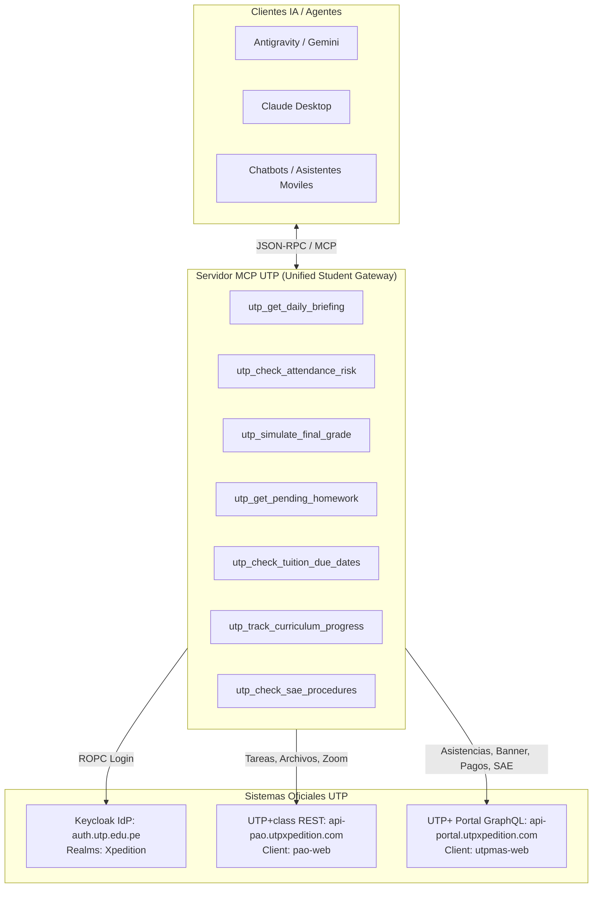
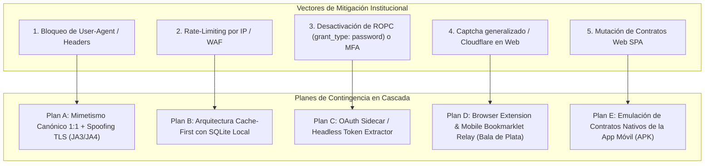
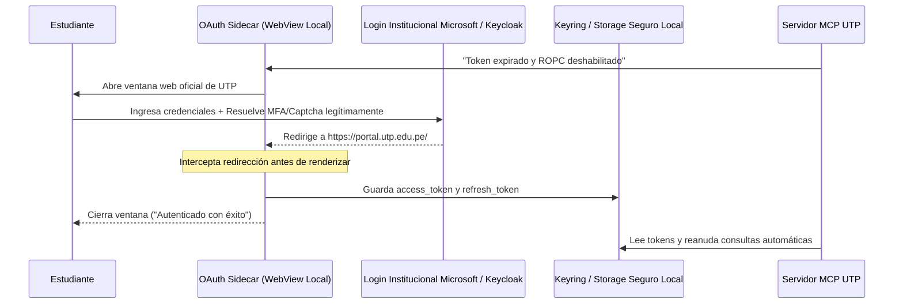

# UTP+class (PAO) API Reverse Engineering & Architecture Checkpoint

Documentación técnica detallada de la arquitectura interna, flujo de autenticación y catálogo de endpoints REST de la plataforma universitaria **UTP+class** (`class.utp.edu.pe`).

---

## 1. Arquitectura General y Servicios

La aplicación UTP+class es una Single Page Application (SPA) construida en React que consume una arquitectura orientada a microservicios tras un API Gateway centralizado:

* **Frontend Web**: `https://class.utp.edu.pe`
* **Identity Provider (IdP)**: Keycloak OIDC en `https://auth.utp.edu.pe/realms/Xpedition`
* **API Gateway (Core PAO)**: `https://api-pao.utpxpedition.com`
* **Gestor de Contenidos / CDN**: AWS S3 / CloudFront (`*.cloudfront.net`) para sílabos y adjuntos.

---

## 2. Autenticación y Tokens

### 2.1 Flujo OIDC y Login Headless Directo (Sin Navegador)
La plataforma utiliza Keycloak como Identity Provider bajo el realm `Xpedition`. Un hallazgo crítico de seguridad e integración es que el cliente público `pao-web` tiene habilitado el flujo **Resource Owner Password Credentials (ROPC / `grant_type=password`)**. Esto permite autenticar scripts de Python o microservicios directamente sin emular un navegador con Playwright ni resolver redirects OIDC interactivos:

* **Endpoint de Token**: `POST https://auth.utp.edu.pe/realms/Xpedition/protocol/openid-connect/token`
* **Content-Type**: `application/x-www-form-urlencoded`
* **Parámetros**:
  ```http
  client_id=pao-web
  grant_type=password
  username=u23307609
  password=<TU_CONTRASEÑA>
  ```
* **Respuesta Exitosa (`200 OK`)**:
  ```json
  {
    "access_token": "eyJhbGciOiJSUzI1Ni...",
    "expires_in": 300,
    "refresh_expires_in": 1800,
    "refresh_token": "eyJhbGciOiJSUzI1Ni...",
    "token_type": "Bearer",
    "id_token": "eyJhbGciOiJSUzI1Ni...",
    "session_state": "..."
  }
  ```

### 2.2 Claims Relevantes del JWT
Al decodificar el `access_token` (payload base64 de Keycloak UTP) se obtienen los identificadores de identidad del estudiante:
* `preferred_username` / `username`: Código oficial del estudiante (ej: `U23307609`), a partir del cual se deriva determinísticamente el `paoUserId` (UUIDv5) para la cabecera `user-id` (conforme a la §19).
* `sub`: Identificador de sujeto en el SSO de Keycloak UTP.
* `email`: Correo institucional del estudiante.

> **Aclaración de Tenant (`x-tenant-id`)**: El identificador de tenant (`a5f469d2-3c0e-5c68-8d32-5265923a8e40`) no es un claim del JWT del alumno, sino una **constante de infraestructura institucional** de la UTP ante la plataforma PAO (§3, §19). Si en el futuro un JWT declarase el claim `tenantId`, el adaptador lo prioriza; en caso contrario, se resuelve el tenant institucional centralizado (`utp.tenant-id` / `UTP_TENANT_ID`).

---

## 3. Cabeceras HTTP Obligatorias

Todas las llamadas hacia `https://api-pao.utpxpedition.com` exigen estrictamente el siguiente conjunto de headers. Omitir cualquiera resultará en `401 Unauthorized` o `400 Bad Request`:

| Cabecera | Tipo | Descripción | Ejemplo |
| :--- | :--- | :--- | :--- |
| `Authorization` | String | Bearer Token JWT | `Bearer eyJhbGciOiJSUzI1...` |
| `user-id` | UUID | ID único del estudiante | `4e535263-79a0-5890-ae33-72a7aa0629ab` |
| `user-role` | String | Rol activo | `STUDENT` |
| `x-tenant-id` | UUID | Identificador del Tenant UTP | `a5f469d2-3c0e-5c68-8d32-5265923a8e40` |
| `transaction-id` | UUID v4 | Identificador de trazabilidad por petición | `c1f28b49-0d19-4a4b-9724-42b7e17409f1` |
| `Content-Type` | String | Formato de datos | `application/json` |

---

## 4. Catálogo Detallado de Endpoints

### 4.1 Periodos Académicos
Obtiene el historial de periodos del alumno y el ciclo activo.

* **Método**: `GET`
* **Ruta**: `/course/student/{userId}/academicperiods`
* **Parámetros**:
  * `userId`: UUID del alumno (derivado determinísticamente por UUIDv5 conforme a §19).
* **Respuesta exacta verificada en vivo (Playwright MCP contra backend PAO)**:
```json
{
  "success": true,
  "code": 2,
  "message": "OK",
  "data": {
    "academicPeriods": [
      {
        "id": "cd9740d6-172d-52d6-8884-75548942072c",
        "period": "9999",
        "acadCareer": "PRED",
        "module": "000",
        "name": "Período Predeterminado",
        "active": true,
        "start": "1900-01-01",
        "end": "2100-12-31",
        "sectionId": "c10d5373-728d-5f35-b1b1-502695a43a49",
        "type": "CURRENT_PERIOD",
        "displaySetting": null,
        "code": "9999PRED000",
        "tenantId": "a5f469d2-3c0e-5c68-8d32-5265923a8e40",
        "parsedStartDate": "1900-01-01",
        "priority": 2
      },
      {
        "id": "95fdb1ee-1b96-5f61-ab7e-6149c896f891",
        "period": "2263",
        "acadCareer": "PREG",
        "module": "001",
        "name": "2026 - Ciclo 2 Agosto PREG (001)",
        "active": true,
        "start": "2026-08-10",
        "end": "2026-12-08",
        "sectionId": "4853a86a-4e82-5d4f-b14b-10ec8addcc91",
        "type": "CURRENT_PERIOD",
        "displaySetting": null,
        "code": "2263PREG001",
        "tenantId": "a5f469d2-3c0e-5c68-8d32-5265923a8e40",
        "parsedStartDate": "2026-08-10",
        "priority": 2
      },
      {
        "id": "28586594-55ce-539b-bb26-4633bedf2f63",
        "period": "2262",
        "acadCareer": "PREG",
        "module": "001",
        "name": "2026 - Ciclo 1 Marzo PREG (001)",
        "active": true,
        "start": "2026-03-23",
        "end": "2026-07-21",
        "type": "OLD_PERIOD",
        "code": "2262PREG001"
      }
    ]
  }
}
```
* **Campos clave para el parser**:
  * `data.academicPeriods`: Array contenedor en el payload raíz.
  * `period`: Código numérico canónico de ciclo (`"2263"`, `"9999"`).
  * `code`: Código institucional compuesto (`"2263PREG001"`, `"9999PRED000"`).
  * `acadCareer`: `"PREG"` para pregrado regular vs `"PRED"` para el contenedor permanente.
  * `type`: `"CURRENT_PERIOD"` denota periodo activo (pueden coexistir `PREG` y `PRED`).
  * `start` y `end`: Fechas límite del ciclo en formato `YYYY-MM-DD` (`"2026-08-10"` a `"2026-12-08"`).

---

### 4.2 Cursos y Secciones del Dashboard
Lista todos los cursos matriculados del periodo actual, incluyendo ID de curso, sección, nombres de docentes y modalidad.

* **Método**: `GET`
* **Ruta**: `/learning/student/{userId}/dashboard-courses`
* **Parámetros**:
  * `userId`: UUID del alumno.
* **Respuesta típica**:
```json
{
  "courses": [
    {
      "courseId": "29b3fddb-e8dc-50cc-8e5c-9a3a2d3cd1bb",
      "sectionId": "4853a86a-4e82-5d4f-b14b-10ec8addcc91",
      "courseCode": "34374",
      "courseName": "Desarrollo Web Integrado",
      "modality": "PRESENCIAL",
      "credits": 4,
      "teachers": [
        {
          "name": "Juan Perez",
          "email": "docente@utp.edu.pe"
        }
      ]
    }
  ]
}
```

---

### 4.3 Detalle de Sección y Docentes
Devuelve metadatos específicos del aula, sede, horarios de clase y cuerpo docente.

* **Método**: `GET`
* **Ruta**: `/course/student/courses/{courseId}/sections/{sectionId}`
* **Parámetros de ruta**:
  * `courseId`: UUID del curso.
  * `sectionId`: UUID de la sección.

---

### 4.4 Sílabo Oficial (PDF)
Retorna la URL presignada o enlace directo de descarga del documento curricular en PDF.

* **Método**: `GET`
* **Ruta**: `/course/student/courses/{courseId}/sections/{sectionId}/syllabus`
* **Respuesta típica**:
```json
{
  "syllabusUrl": "https://s3.amazonaws.com/utp-syllabus-prod/34374_Desarrollo_Web_Integrado.pdf"
}
```

---

### 4.5 Contenido Completo del Curso (Unidades, Semanas, Temas y Materiales)
Es el endpoint nuclear para extraer toda la estructura didáctica del curso: unidades temáticas, semanas de clase, sesiones, lecturas, enlaces externos, grabaciones y diapositivas.

* **Método**: `GET`
* **Ruta**: `/course/student/courses/{courseId}/sections/{sectionId}/full`
* **Respuesta típica**:
```json
{
  "units": [
    {
      "unitId": "...",
      "unitNumber": 1,
      "title": "Arquitectura de Software y Frontend Moderno",
      "weeks": [
        {
          "weekNumber": 1,
          "topics": [
            {
              "topicId": "...",
              "name": "Introducción al Stack MERN / Next.js",
              "materials": [
                {
                  "type": "DOCUMENT",
                  "title": "Semana 01 - Diapositivas.pdf",
                  "url": "https://..."
                },
                {
                  "type": "LINK",
                  "title": "Documentación Oficial MDN",
                  "url": "https://developer.mozilla.org"
                }
              ]
            }
          ]
        }
      ]
    }
  ]
}
```

---

### 4.6 Progreso del Alumno en el Curso
Muestra el porcentaje de materiales revisados y avance del estudiante en la sección.

* **Método**: `GET`
* **Ruta**: `/learning/student/{userId}/courses/{courseId}/sections/{sectionId}/progress`

---

### 4.7 Tareas y Entregables (Homework)

#### A. Listado de tareas de la sección y vinculación con notas
* **Método**: `GET`
* **Ruta**: `/course/student/courses/{courseId}/sections/{sectionId}/contents/homework/`
* **Estructura devuelta**:
  * `section`: Fechas del ciclo (`start`, `end`), campus, carrera (`acadCareer`), facultad, `numWeeks`, y `currentWeekDetail`.
  * `evaluationSystem`: Sistema de evaluación con los tipos de nota (`PA`, `PC1`, `PC2`, `PROY`, `EF`) y ponderaciones.
  * `content[]`: Array de tareas con:
    * `metadata.type`: A qué nota del curso tributa la tarea (ej. `PC1`, `PA`).
    * `metadata.topScore`: Puntaje máximo (ej. `20`).
    * `metadata.derivables`: Entregables esperados en formato HTML rico.
    * `statusActivityStudent`: Estado del alumno (`MISSING`, `DELIVERED`, `GRADED`).
    * `visibleFrom` y `visibleTo`: Rango de visibilidad y fecha límite.

#### B. Detalle individual de una tarea (Consignas, Rúbrica y Estado)
Al ingresar a una tarea específica, el endpoint `GET .../resume` entrega el modelo completo de entrega:
* **Método**: `GET`
* **Ruta**: `/course/student/sections/{sectionId}/homeworks/{homeworkId}/resume`
* **Respuesta exacta verificada**:
```json
{
  "success": true,
  "code": 2,
  "data": {
    "id": "010f5746-8b55-4fd1-b016-25150eab49e0",
    "title": "s15.1-Tarea",
    "content": "<p>laboratorio con indicaciones completas del docente en HTML</p>",
    "deliverables": "<p>informe en formato PDF / Word</p>",
    "isQualified": "true",
    "evaluationTopScore": 20,
    "availableFrom": "2026-07-02 20:36:00",
    "availableUntil": "2026-07-03 23:59:00",
    "attempts": 2,
    "qualificationType": "LAST",
    "isGroup": false,
    "teamSetId": null,
    "homeworkStatus": "OUT_OF_DATE",
    "assignmentStatus": "CREATED",
    "assignmentProgress": "NOT_STARTED",
    "homeworkLastAttempt": null,
    "rubric": null,
    "files": [],
    "assignmentIsNsp": false,
    "assignmentIsPlagiarized": false,
    "assignmentDiscountScore": null,
    "isFlexibleEvaluation": false
  }
}
```
* **Campos clave para automatización**:
  * `content`: Instrucciones redactadas por el profesor (HTML con enlaces, código y formatos).
  * `deliverables`: Especificaciones de qué archivo espera recibir el profesor.
  * `isGroup`: Si es `true`, la entrega debe hacerse mediante el endpoint de equipos con `teamSetId`.
  * `qualificationType`: `"LAST"` (toma la nota del último intento) o `"HIGHEST"` (toma el puntaje más alto).
  * `attempts`: Límite máximo de intentos disponibles.
  * `homeworkLastAttempt`: Contiene los archivos entregados anteriormente si el alumno ya realizó un intento.
  * `rubric`: Rúbrica desglosada por criterios y escalas de puntuación.
  * `assignmentIsPlagiarized`: Indicador de detección de copia / plagio.
  * `assignmentDiscountScore`: Descuento de puntos por penalización o retraso.

#### C. Flujo Completo de Envío y Entrega de Tareas (Upload / Submissions)
Para entregar la solución a una tarea (subir archivo y registrar intento):
1. **Obtención de Presigned URL en S3**:
   * **Método**: `POST`
   * **Ruta**: `/learning/general/files/courses/{courseId}/sections/{sectionId}` (o `/learning/general/files`)
   * **Body**: Metadatos del archivo a subir.
   * **Respuesta**:
     ```json
     {
       "uploadURL": "https://utp-prd-upload-file-storage.s3.amazonaws.com/pao/content/...?...AWSAccessKeyId=...",
       "path": {
         "bucket_url": "https://utp-prd-upload-file-storage.s3.amazonaws.com/pao/content/..."
       }
     }
     ```
2. **Subida Binaria a S3**:
   * **Método**: `PUT` directo a `uploadURL` con los bytes del archivo y el header `Content-Type: application/pdf` (o formato correspondiente).
3. **Confirmación y Envío Formal de la Tarea**:
   * **Tarea Individual**:
     * **Método**: `PUT`
     * **Ruta**: `/course/student/sections/{sectionId}/assignments/{homeworkId}/send`
     * **Body**:
       ```json
       {
         "files": [
           {
             "id": "file-uuid-generado",
             "name": "Informe_Lab15_Joan.pdf",
             "url": "https://utp-prd-upload-file-storage.s3.amazonaws.com/pao/content/...",
             "size": 1048576
           }
         ],
         "comment": "Entrega de laboratorio 15",
         "submissionType": "FILE"
       }
       ```
   * **Tarea Grupal**:
     * **Método**: `POST`
     * **Ruta**: `/course/student/sections/{sectionId}/homework/{homeworkId}/teams/{teamSetId}/send`
     * **Body**:
       ```json
       {
         "files": [...],
         "teamId": "uuid-del-equipo",
         "comment": "Entrega grupal de equipo"
       }
       ```

---

### 4.8 Descarga de Materiales (PDF, Word, PPT) y Marcado de Progreso

#### A. Ubicación y Descarga Directa de Archivos
Los materiales no se transmiten como base64, sino como URLs directas en AWS S3:
* **Host CDN / S3**: `https://utp-prd-upload-file-storage.s3.amazonaws.com/pao/content/{folderId}/{filename}`
* En el endpoint `/full`, cada elemento del array `materials[]` contiene directamente el atributo `url` hacia este bucket de S3.
* **Descarga**: Para descargarlos programáticamente, se realiza un `GET` directo a la URL de S3 sin necesidad de cabeceras de sesión de la UTP.

#### B. Registro de Progreso / Material Revisado
Al abrir un PDF o material, la web notifica a la API para marcar el estado como `Revisado`:
* **Método**: `PUT`
* **Ruta**: `/learning/student/{userId}/courses/{courseId}/sections/{sectionId}/contents/{contentId}/progress`
* **Body**: `{"viewed": true}`

---

### 4.9 Determinación de la Semana Actual (`currentWeek`)

¿Cómo sabe el sistema en qué semana se encuentra para desplegarla automáticamente?
1. **Endpoint de Sección**:
   Al consultar `GET /course/student/courses/{courseId}/sections/{sectionId}`, el objeto `section` responde con:
   ```json
   {
     "numWeeks": 18,
     "currentWeek": 15,
     "startDate": "2026-08-15T00:00:00.000Z",
     "endDate": "2026-12-15T00:00:00.000Z"
   }
   ```
2. **Persistencia en Cliente**:
   El frontend almacena este valor directamente en `localStorage.setItem("currentWeek", "15")`.
3. **Comportamiento en UI**:
   El componente de acordeón lee `currentWeek` para mantener automáticamente abierta la semana en curso (Semana 15) y colapsadas las demás.

---

### 4.10 Resumen de Actividades Pendientes (Todas las materias)
Permite al estudiante ver en una sola llamada todas las tareas y actividades próximas a vencer de todos sus cursos matriculados.

* **Método**: `GET`
* **Ruta**: `/course/student/activities/pending/resume`

---

### 4.11 Evaluaciones y Ponderaciones
Obtiene la lista de evaluaciones formales (Prácticas Calificadas, Evaluaciones Continuas, Examen Final) con sus respectivos pesos en la fórmula de notas.

* **Método**: `GET`
* **Ruta**: `/course/student/courses/{courseId}/sections/{sectionId}/contents/evaluation/`

---

### 4.12 Calificaciones y Notas (Grades)
Entrega el desglose exacto de notas obtenidas por el alumno, pesos porcentuales y cálculo de promedio.

* **Método**: `GET`
* **Ruta**: `/course/student/sections/{sectionId}/grade`
* **Respuesta típica**:
```json
{
  "formula": "(PC1*0.2) + (PC2*0.2) + (PA*0.2) + (EF*0.4)",
  "grades": [
    { "evaluationName": "PC1", "weight": 0.2, "score": 18.0 },
    { "evaluationName": "PC2", "weight": 0.2, "score": 17.5 },
    { "evaluationName": "PA",  "weight": 0.2, "score": 19.0 },
    { "evaluationName": "EF",  "weight": 0.4, "score": null }
  ],
  "currentAverage": 18.1
}
```

---

### 4.13 Foros de Discusión (Hilos, Comentarios y Réplicas)

#### A. Listado de Foros de la Sección
* **Método**: `GET`
* **Ruta**: `/course/student/courses/{courseId}/sections/{sectionId}/contents/forum/`

#### B. Resumen y Consigna del Foro
* **Método**: `GET`
* **Ruta**: `/forum/student/sections/{sectionId}/forum/{forumId}/resume?includeComments=false`

#### C. Comentarios del Foro (Paginados)
* **Método**: `GET`
* **Ruta**: `/forum/student/{userId}/courses/{courseId}/sections/{sectionId}/forums/{forumId}/comment?role=student&page={pageNumber}`

#### D. Publicar Nuevo Comentario o Respuesta
* **Método**: `POST`
* **Ruta**: `/forum/student/{userId}/courses/{courseId}/sections/{sectionId}/forums/{forumId}/comment`
* **Body**:
  ```json
  {
    "parentId": "uuid-del-comentario-padre-si-es-replica",
    "description": "<p>Texto de la duda o respuesta en formato HTML</p>"
  }
  ```

#### E. Editar o Eliminar Comentario
* **Editar**: `PUT /forum/student/{userId}/courses/{courseId}/sections/{sectionId}/forums/{forumId}/comment/{commentId}` con `{"description": "..."}`
* **Eliminar**: `DELETE /forum/student/{userId}/courses/{courseId}/sections/{sectionId}/forums/{forumId}/comment/{commentId}`

---

### 4.14 Videoconferencias y Grabaciones de Zoom

La pestaña `/zoom` centraliza la sincronización con Zoom Meetings:
* **Método**: `GET`
* **Ruta**: `/course/student/video-conference/meeting?courseId={courseId}&sectionId={sectionId}`
* **Estructura devuelta**:
  * **Próximas clases**: `title`, `startTime`, `meetingId`, `joinUrl` (enlace directo a la sala en vivo).
  * **Clases pasadas**: Incluye el estado de grabación (`RECORDING_AVAILABLE`) y el enlace directo de reproducción en Zoom Cloud:
    `https://utpvirtual.zoom.us/rec/play/{hashZoomToken}`.

---

### 4.15 Anuncios Oficiales del Docente

Comunicados de clase, avisos de reprogramación y material de último minuto:
* **Listado de Anuncios**:
  * **Método**: `GET`
  * **Ruta**: `/communication/student/announcement/reader/{userId}?course={courseId}&sectionId={sectionId}`
* **Marcar Anuncio como Visto / Leído**:
  * **Método**: `PUT`
  * **Ruta**: `/communication/student/announcement/{announcementId}/reader/{userId}/to-seen`

---

### 4.16 Asistencias e Inasistencias (Arquitectura y Resolución Oficial)
En el microservicio didáctico de UTP+class no existe un módulo directo de asistencias (los docentes a veces adjuntan reportes Excel en la sección *Anuncios*).
Sin embargo, **el registro oficial y en tiempo real de asistencias de la universidad está 100% resuelto y disponible a través de la API GraphQL de UTP+ Portal (`api-portal.utpxpedition.com/graphql`)** mediante la query `getClassAttendance`, documentada en detalle en la **Parte II** de esta especificación. Permite auditar sesión a sesión asistencias (`P`), inasistencias (`F`), pendientes (`PE`) y no registradas (`NR`) para evitar la desaprobación por inasistencias (DPI).

---

### 4.17 Horarios y Calendario Académico (Clases y Deadlines)

El sistema de calendario no solo muestra bloques horarios; es el motor central que cruza clases en vivo, enlaces Zoom y fechas límite de entrega en un solo modelo unificado.

#### A. Horario de Clases Semanales y Todo el Ciclo
* **Método**: `GET`
* **Ruta**: `/course/student/calendar`
* **Query Params**:
  * `userId`: UUID del estudiante.
  * `dateToQuery`: Lunes de la semana a consultar (ej. `2026-11-16+00:00:00`).
  * `intervalMode`: `period` (entrega todas las clases del semestre), `week` o `day`.
* **Estructura de Respuesta**:
  * Encapsulado en `data.current_interval`, `data.next_interval` y `data.previous_interval`, que permite paginar semanas hacia adelante/atrás con fechas exactas:
    ```json
    {
      "period_name": "2026 - Ciclo 2 Agosto",
      "week_number": 15,
      "total_weeks": 18,
      "current_date": "2026-11-20 21:55:00",
      "start_of_interval": "2026-11-16 00:00:00",
      "end_of_interval": "2026-11-22 23:59:59",
      "events": [
        {
          "id": "e925c0e5-edf3-501c-a714-6aeb633ee28c",
          "title": "DESARROLLO WEB INTEGRADO (34374) (Semana 15) - Jueves",
          "modality": "P",
          "type": "CLASS",
          "startAt": "2026-11-19 16:00:00",
          "finishAt": "2026-11-19 18:15:00",
          "isLongLasting": false,
          "metadata": {
            "courseId": "29b3fddb-e8dc-50cc-8e5c-9a3a2d3cd1bb",
            "sectionId": "4853a86a-4e82-5d4f-b14b-10ec8addcc91",
            "zoomLink": "https://utpvirtual.zoom.us/j/82423271891",
            "latestZoomRecordingId": "70b0183f-90df-4afc-bacf-f111b7b4cc93",
            "isLive": false
          }
        }
      ]
    }
    ```
* **Ventajas para Automatización**:
  * `metadata.isLive`: Bandera booleana que indica si una clase está ocurriendo **en tiempo real**.
  * `metadata.zoomLink`: Entrega el link de Zoom directo de cada sesión sin requerir navegar al tab de videoconferencias.
  * `metadata.latestZoomRecordingId`: ID directo de la grabación si la clase ya concluyó.

#### B. Calendario de Entregas y Vencimientos (Activities)
Cruza en el calendario todos los plazos límites de tareas, foros y prácticas de todas las materias:
* **Método**: `GET`
* **Ruta**: `/course/student/calendar/activities`
* **Query Params**: Idénticos a `/calendar`.
* **Objeto de Evento en `events[]`**:
  ```json
  {
    "id": "22a4e0c2-8314-5087-be6f-d68732b89149",
    "title": "Tarea Aprendiendo de las Charlas TED",
    "modality": "VT",
    "type": "ACTIVITY",
    "startAt": "2026-11-16 00:00:00",
    "finishAt": "2026-11-22 23:59:00",
    "metadata": {
      "courseName": "HERRAMIENTAS PARA LA COMUNICACIÓN EFECTIVA",
      "activityType": "HOMEWORK",
      "studentStatus": "MISSING",
      "weekNumber": 15,
      "courseId": "24577268-593a-5db7-a592-d676a656f171",
      "sectionId": "7eddf3c8-98eb-5d6e-a295-856ce4ee6c3c",
      "activityId": "22a4e0c2-8314-5087-be6f-d68732b89149",
      "contentId": "22a4e0c2-8314-5087-be6f-d68732b89149",
      "isReinforcementActivity": false
    }
  }
  ```
* **Ventajas para Automatización**:
  * `metadata.studentStatus`: Indica de inmediato si la tarea está `MISSING` (pendiente/por entregar), `DELIVERED` (entregada) o calificada.
  * `metadata.activityType`: Distingue entre `HOMEWORK`, `FORUM` o `EVALUATION`.

---

## 5. Implementaciones de Referencia

### 5.1 Cliente en JavaScript / TypeScript (`fetch`)

```typescript
import { randomUUID } from "crypto";

const CONFIG = {
  baseUrl: "https://api-pao.utpxpedition.com",
  userId: "4e535263-79a0-5890-ae33-72a7aa0629ab",
  tenantId: "a5f469d2-3c0e-5c68-8d32-5265923a8e40",
  token: "eyJhbGciOiJSUzI1Ni..."
};

async function utpFetch<T>(endpoint: string, options: RequestInit = {}): Promise<T> {
  const url = `${CONFIG.baseUrl}${endpoint}`;
  const response = await fetch(url, {
    ...options,
    headers: {
      "Authorization": `Bearer ${CONFIG.token}`,
      "user-id": CONFIG.userId,
      "user-role": "STUDENT",
      "x-tenant-id": CONFIG.tenantId,
      "transaction-id": randomUUID(),
      "Content-Type": "application/json",
      ...(options.headers || {})
    }
  });

  if (!response.ok) {
    throw new Error(`HTTP Error ${response.status}: ${response.statusText}`);
  }

  return response.json() as Promise<T>;
}
```

---

### 5.2 Cliente en Python 100% Headless (Sin Navegador ni Playwright)

Este script realiza el login directo en Keycloak usando `grant_type=password`, decodifica los tokens JWT y consulta los cursos, grabaciones de Zoom, anuncios y notas:

```python
import uuid
import base64
import json
import requests

KEYCLOAK_URL = "https://auth.utp.edu.pe/realms/Xpedition/protocol/openid-connect/token"
API_BASE_URL = "https://api-pao.utpxpedition.com"
CLIENT_ID = "pao-web"

class UtpClient:
    def __init__(self, username, password):
        self.username = username
        self.password = password
        self.access_token = None
        self.user_id = None
        self.tenant_id = None
        self.login()

    def login(self):
        """Autenticación directa en Keycloak (ROPC) sin navegador."""
        data = {
            "client_id": CLIENT_ID,
            "grant_type": "password",
            "username": self.username,
            "password": self.password
        }
        res = requests.post(KEYCLOAK_URL, data=data)
        res.raise_for_status()
        token_data = res.json()
        self.access_token = token_data["access_token"]

        # Decodificar payload del JWT
        payload_b64 = self.access_token.split(".")[1] + "=="
        payload = json.loads(base64.b64decode(payload_b64).decode("utf-8"))
        self.user_id = payload.get("sub") or payload.get("userId")
        self.tenant_id = payload.get("tenantId", "a5f469d2-3c0e-5c68-8d32-5265923a8e40")
        print(f"[OK] Sesion iniciada para {self.username} (User ID: {self.user_id})")

    def _headers(self):
        return {
            "Authorization": f"Bearer {self.access_token}",
            "user-id": self.user_id,
            "user-role": "STUDENT",
            "x-tenant-id": self.tenant_id,
            "transaction-id": str(uuid.uuid4()),
            "Content-Type": "application/json"
        }

    def get_courses(self):
        url = f"{API_BASE_URL}/learning/student/{self.user_id}/dashboard-courses"
        return requests.get(url, headers=self._headers()).json()

    def get_zoom_meetings(self, course_id, section_id):
        url = f"{API_BASE_URL}/course/student/video-conference/meeting"
        params = {"courseId": course_id, "sectionId": section_id}
        return requests.get(url, headers=self._headers(), params=params).json()

    def get_announcements(self, course_id, section_id):
        url = f"{API_BASE_URL}/communication/student/announcement/reader/{self.user_id}"
        params = {"course": course_id, "sectionId": section_id}
        return requests.get(url, headers=self._headers(), params=params).json()

    def get_course_grades(self, section_id):
        url = f"{API_BASE_URL}/course/student/sections/{section_id}/grade"
        return requests.get(url, headers=self._headers()).json()

if __name__ == "__main__":
    # Ejemplo de uso con credenciales
    client = UtpClient("u23307609", "926867181Utp))")
    courses = client.get_courses()
    print("Cursos encontrados:", len(courses.get("courses", [])))
```

---

### 5.3 Ejemplo cURL Directo (Headless Token + Query)

```bash
# 1. Obtener Token JWT en un solo comando
TOKEN=$(curl -s -X POST "https://auth.utp.edu.pe/realms/Xpedition/protocol/openid-connect/token" \
  -d "client_id=pao-web" \
  -d "grant_type=password" \
  -d "username=u23307609" \
  -d "password=TU_PASSWORD" | jq -r .access_token)

# 2. Consultar cursos inscritos
curl -X GET "https://api-pao.utpxpedition.com/learning/student/4e535263-79a0-5890-ae33-72a7aa0629ab/dashboard-courses" \
  -H "Authorization: Bearer $TOKEN" \
  -H "user-id: 4e535263-79a0-5890-ae33-72a7aa0629ab" \
  -H "user-role: STUDENT" \
  -H "x-tenant-id: a5f469d2-3c0e-5c68-8d32-5265923a8e40" \
  -H "transaction-id: $(uuidgen)" \
  -H "Content-Type: application/json"
```

---

## 6. Consideraciones de Seguridad y Buenas Prácticas

1. **Rotación del Token**: Dado que los tokens JWT de Keycloak expiran rápidamente, para procesos en segundo plano o automatizaciones a largo plazo se debe almacenar el `refresh_token` y renovar mediante POST hacia:
   `https://auth.utp.edu.pe/realms/Xpedition/protocol/openid-connect/token` con `grant_type=refresh_token`.
2. **UUIDs Únicos por Petición**: El gateway registra métricas y audita usando `transaction-id`. Generar un nuevo UUID v4 en cada petición evita colisiones y falsos positivos de rate-limiting.
3. **Control de Concurrencia**: Al descargar sílabos o contenidos de todos los cursos en lote, se recomienda un throttle de 200-500 ms entre peticiones para prevenir bloqueos por WAF.

---

# PARTE II: UTP+ Portal (GraphQL API - `api-portal.utpxpedition.com`)

Mientras que UTP+class gestiona la dinámica formativa semanal (tareas, archivos, foros y videoconferencias), **UTP+ Portal (`https://portal.utp.edu.pe`)** es el sistema neurálgico administrativo-académico de la universidad. Utiliza una arquitectura **GraphQL sobre Apollo Server** y expone la vida universitaria completa del estudiante: récord de inasistencias sesión a sesión, récord histórico consolidado de notas (Banner), pensiones y pagos pendientes, trámites de secretaría académica (SAE) y avance de malla curricular.

---

## 7. Arquitectura y Autenticación del Portal

### 7.1 Comparativa Arquitectural Dual UTP

| Dimensión | UTP+class (`class.utp.edu.pe`) | UTP+ Portal (`portal.utp.edu.pe`) |
| :--- | :--- | :--- |
| **API Gateway** | `https://api-pao.utpxpedition.com` (REST microservicios) | `https://api-portal.utpxpedition.com/graphql` (GraphQL Apollo) |
| **Keycloak Client ID** | `pao-web` | `utpmas-web` |
| **Identificador de Usuario** | UUID v4 interno (`sub` / `userId`) | Código de Alumno en mayúsculas (`U23307609`) |
| **Cabeceras de Aplicación** | `x-tenant-id`, `transaction-id`, `user-role: STUDENT` | `applicationId: APP00002`, `user-role: student`, `user-id` |
| **Dominio de Negocio** | Didáctico (Semanas, Tareas, Zoom, Foros, S3) | Académico-Administrativo (Asistencias, Récord Banner, Pensiones, SAE, Malla) |

---

### 7.2 Flujo de Autenticación Headless (ROPC Directo)
El portal comparte el Identity Provider Keycloak (`https://auth.utp.edu.pe/realms/Xpedition`), pero utiliza el cliente `utpmas-web`. También permite login directo sin interfaz ni navegador:

* **Endpoint**: `POST https://auth.utp.edu.pe/realms/Xpedition/protocol/openid-connect/token`
* **Content-Type**: `application/x-www-form-urlencoded`
* **Body**:
  ```http
  client_id=utpmas-web
  grant_type=password
  username=u23307609
  password=<TU_CONTRASEÑA>
  ```
* **Respuesta**: Token JWT con `access_token` y `refresh_token`.

### 7.3 Cabeceras HTTP Requeridas para GraphQL
Toda petición POST hacia `https://api-portal.utpxpedition.com/graphql` debe incluir:
```http
Authorization: Bearer <access_token_de_utpmas-web>
applicationId: APP00002
user-id: U23307609
user-role: student
Content-Type: application/json
```

---

## 8. Catálogo Completo de Queries GraphQL Auditadas

### 8.1 Asistencia Oficial Sesión a Sesión (`getClassAttendance`)
Resuelve el conteo oficial de inasistencias para auditorías preventivas del límite de 30% reglamentario (DPI - Desaprobado por Inasistencias).

* **Operación**: `query getClassAttendance($period: String!, $classNbr: String!)`
* **Variables**:
  ```json
  {
    "period": "2263",
    "classNbr": "56357"
  }
  ```
* **Payload GraphQL**:
  ```graphql
  query getClassAttendance($period: String!, $classNbr: String!) {
    getClassAttendance(request: {periodId: $period, classNbr: $classNbr}) {
      summary {
        attended
        noAttended
        pending
        noRecord
      }
      months {
        name
        dates {
          name
          type
        }
      }
    }
  }
  ```
* **Tipos de Asistencia en `dates[].type`**:
  * `P`: Presente (Attended).
  * `F`: Falta (Inasistencia computada).
  * `PE`: Pendiente (Clase dictada pendiente de firma de asistencia).
  * `NR`: No Registrado (Clases futuras programadas en el calendario).

---

### 8.2 Récord Histórico Consolidado de Notas (`getCoursesGradeRecord`)
Devuelve el historial académico completo de todos los ciclos cursados desde el ingreso del estudiante a la universidad.

* **Operación**: `query getCoursesGradeRecord`
* **Variables**: `{}`
* **Payload GraphQL**:
  ```graphql
  query getCoursesGradeRecord {
    getCoursesGradeRecord {
      name
      items {
        cycle
        courseName
        grade
        approvalStatus
        catalogNumber
        numberTimes
        weeklyHours
        credits
        section
      }
    }
  }
  ```
* **Campos Destacados**:
  * `approvalStatus`: `Aprobado` o `Desaprobado`.
  * `numberTimes`: Veces que se cursó la materia (1 = primera vez, 2 = segunda vez, etc.).
  * `cycle`: Ciclo relativo de la malla (`01`, `02`, `03`...).

---

### 8.3 Resumen de Cursos del Ciclo y Fórmulas de Evaluación (`getCourseSummary`)
Extrae las asignaturas matriculadas en el ciclo vigente y, de manera crucial, la **fórmula matemática oficial de ponderación de notas** configurada por la secretaría académica.

* **Operación**: `query getCourseSummary($periodId: String!)`
* **Variables**:
  ```json
  {
    "periodId": "2263"
  }
  ```
* **Payload GraphQL**:
  ```graphql
  query getCourseSummary($periodId: String!) {
    getCourseSummary(periodId: $periodId) {
      summary {
        campus
        enrolledCourses
        relativeCycle
        creditCount
        weeklyHours
      }
      courses {
        courseId
        title
        catalogNumber
        approvalStatus
        section
        credits
        weeklyHours
        professors
        formula
        evaluations {
          name
          shortName
          value
        }
      }
    }
  }
  ```
* **Ejemplo Real de `formula` y `evaluations`**:
  * `formula`: `"10%*[ATI1] + 20%*[ATI2] + 20%*[ATI3] + 20%*[PA] + 30%*[TI]"`
  * `evaluations`:
    * `ATI1`: `17.00`
    * `ATI2`: `19.00`
    * `ATI3`: `20.00`
    * `PA`: Pendiente (`0.02` en sistema UTP denota nota aún no ingresada).
    * `TI`: Pendiente.
  * **Poder de Automatización**: Permite a un modelo de IA resolver exactamente la ecuación:
    $$\text{Nota Final} = 0.10(17) + 0.20(19) + 0.20(20) + 0.20(\text{PA}) + 0.30(\text{TI})$$
    e indicar al alumno la nota mínima exacta que requiere en cada rubro restante para alcanzar el promedio deseado.

---

### 8.4 Pensiones y Cuotas Pendientes (`pendingPayments`)
Audita el estado financiero del alumno para evitar recargos por mora y aprovechar los descuentos por pronto pago.

* **Operación**: `query getPendingPayments`
* **Variables**: `{}`
* **Payload GraphQL**:
  ```graphql
  query getPendingPayments {
    pendingPayments {
      summary {
        totalPendingAmount
        totalRecharge
        totalInstallmentsToPaid
      }
      items {
        name
        periodDesc
        itemNumber
        amount
        amountWithBenefits
        amountToPay
        status
        hasDiscountProntoPago
        discountProntoPago
        dueDate
        paymentType {
          id
          desc
        }
      }
    }
  }
  ```
* **Datos Clave**:
  * `dueDate`: Timestamp epoch milisegundos de la fecha límite de pago.
  * `discountProntoPago`: Monto exacto de rebaja si se cancela antes del corte.
  * `paymentType.desc`: `PENSIONES`, `MATRÍCULA` o `SEGUROS` (Programa de Salud Estudiantil PSE).

---

### 8.5 Historial de Pagos Realizados (`paidPayments`)
Comprobantes de pago y auditoría de transacciones concluidas en el ciclo.

* **Operación**: `query paidPayments($period: String!)`
* **Variables**: `{"period": "2263"}`
* **Payload GraphQL**:
  ```graphql
  query paidPayments($period: String!) {
    paidPayments(period: $period) {
      items {
        name
        amount
        amountToPay
        datePayment
        status
        discountProntoPago
      }
    }
  }
  ```

---

### 8.6 Avance del Plan de Estudios / Malla Curricular (`planProgress`)
Rastrea el progreso global de la carrera según los créditos exigidos por el plan de estudios.

* **Operación**: `query getAcademicPlanProgress($acadPlan: String!, $prog: String!)`
* **Variables**:
  ```json
  {
    "acadPlan": "SIST2653A",
    "prog": "PST50"
  }
  ```
* **Payload GraphQL**:
  ```graphql
  query getAcademicPlanProgress($acadPlan: String!, $prog: String!) {
    planProgress {
      resume(acadPlan: $acadPlan, prog: $prog) {
        isProcessing
        requiredCourses {
          approved
          pending
          total
        }
        credits {
          required {
            approved
            pending
            total
          }
          optional {
            approved
            pending
            total
          }
          resume {
            total
            approved
            pending
            approvedPercent
            pendingPercent
          }
        }
      }
    }
  }
  ```
* **Datos Auditados**: 44 cursos obligatorios aprobados, 24 pendientes (68 en total); 130 créditos acumulados de 200 requeridos (65% completado).

---

### 8.7 Estado de Trámites SAE en Línea (`procedures`)
Monitorea en tiempo real los expedientes ingresados al Servicio de Atención al Estudiante (SAE).

* **Operación**: `query getProceduresByStudent`
* **Variables**: `{}`
* **Payload GraphQL**:
  ```graphql
  query getProceduresByStudent {
    procedures {
      requests {
        id
        procedureId
        name
        status {
          status
          name
          description
        }
        duration
        createdDate
        startDate
        estimatedEndDate
        realEndDate
      }
    }
  }
  ```
* **Estados Típicos**: `PROCEDE`, `NO_PROCEDE`, `PENDIENTE`, `FINALIZADO`.
* **Catálogo de Procedimientos (`procedureId`)**:
  * `1031`: Cambio de modalidad.
  * `1017`: Rectificación de nota.
  * `1030`: Emisión de carné universitario.
  * `1025`: Constancia de matrícula.
  * `1018`: Constancia de estudios.

---

### 8.8 Horario del Portal con Enlace Puente a UTP+class (`scheduleByDate`)
El endpoint de calendario del portal es la fuente autoritativa de la grilla horaria y contiene la vinculación directa entre el sistema logístico (Banner) y los microservicios didácticos (Canvas PAO):

* **Operación**: `query scheduleByDate($filters: ScheduleFilterInput!)`
* **Variables Típicas**:
  ```json
  {
    "filters": {
      "startDate": "2026-09-21",
      "endDate": "2026-09-27"
    }
  }
  ```
* **Payload GraphQL Autorizado y Completo (AST Verificado)**:
  ```graphql
  query scheduleByDate($filters: ScheduleFilterInput!) {
    scheduleByDate(filters: $filters) {
      dates {
        date
        items {
          name
          period
          hasCrossing
          isRescheduled
          date
          startTime
          endTime
          typeSchedule {
            id
            name
          }
          modality {
            id
            name
            location
          }
          class {
            id
            name
            desc
            descAmb
            classType
            instructionMode
            linkZoom
            linkCourseClass
            hours
            isClass
            isHybrid
            isReprog
            professors {
              firstName
              lastName
            }
            location {
              classRoom {
                id
                desc
                floor
              }
              building {
                id
                image
                desc
                address
                coordinates
              }
            }
          }
        }
      }
    }
  }
  ```
> [!IMPORTANT]
> **Jerarquía AST, Tipado Primitivo y Resolución de Infraestructura**:
> 1. **Ubicación en el AST**: Los campos `classType` e `instructionMode` **NO cuelgan del nodo `items` (`ScheduleItem`)**. Intentar consultarlos directamente en `items` provoca un error de validación `GRAPHQL_VALIDATION_FAILED` ("Cannot query field 'classType' on type 'ScheduleItem'"). Viven exclusivamente anidados dentro del sub-objeto `items[].class`.
> 2. **Tipado String**: A diferencia de `typeSchedule.id` (que es `Integer` numérico `1`), `class.classType` es retornado por el backend de UTP como un **`String` entrecomillado** (ej. `"classType": "5"`). Los modelos en Java/TypeScript deben tiparlo como `String` para prevenir fallos de deserialización en Jackson o desajustes de igualdad estricta (`===`).
> 3. **Evidencia Empírica de `location.building`**: En las respuestas en vivo de `scheduleByDate`, el sub-objeto `class.location.building` devuelve únicamente el `id` (ej. `"SL04_PACIF"`), mientras que sus campos `desc` y `address` son **estrictamente `null`**. Por esta razón, la ejecución de la consulta `query getBuildings` en GraphQL es **100% indispensable** para resolver nombres de edificios y direcciones físicas mediante un patrón Read-Through Cache. Bajo la directiva de CERO DATOS HARDCODEADOS, si el servicio no resuelve un edificio o falla la red, el backend debe preservar el `building.id` crudo y dejar la descripción en `null`, marcando el estado de enriquecimiento como `PARTIAL`.

* **El Puente Maestro (`linkCourseClass`)**:
  Devuelve la URL canónica de UTP+class:
  `https://class.utp.edu.pe/student/courses/{courseUUID}/section/{sectionUUID}/learnv2`.
  Permite que cualquier aplicación que parta del horario del portal resuelva inmediatamente los UUIDs didácticos sin heurísticas ni scraping adicional.

---

# PARTE III: Arquitectura del Asistente de IA (Servidor MCP de UTP)

El ecosistema dual UTP (REST en UTP+class + GraphQL en UTP+ Portal) conforma la base de datos más completa posible para construir un **Servidor MCP (Model Context Protocol)** que permita a modelos como Claude, Gemini, ChatGPT o agentes autónomos operar como el **Copiloto Académico Personal** de cualquier estudiante de la UTP.



---

## 9. Especificación de Herramientas MCP (Tools Schema)

### 9.1 `utp_get_daily_briefing`
* **Descripción**: Genera el resumen matutino inteligente del estudiante. Cruza las clases de hoy (con sus links directos a Zoom y aula física), las tareas que vencen en las próximas 48 horas en UTP+class y alertas de pagos inmediatos.
* **Entrada**: `{ "date"?: "YYYY-MM-DD" }`
* **Salida**:
  ```json
  {
    "classesToday": [
      {
        "course": "GESTIÓN DEL SERVICIO TI",
        "time": "18:30 - 20:00",
        "modality": "Teoría Remoto",
        "zoomLink": "https://utpvirtual.zoom.us/j/86983893466",
        "isLive": false
      }
    ],
    "urgentDeadlines": [
      {
        "course": "HERRAMIENTAS PARA LA COMUNICACIÓN EFECTIVA",
        "activity": "Tarea Aprendiendo de las Charlas TED",
        "due": "2026-11-22 23:59:00",
        "status": "MISSING"
      }
    ],
    "pendingPaymentAlert": {
      "installment": "Cuota 5",
      "amount": "790.00 PEN",
      "dueDate": "2026-11-25"
    }
  }
  ```

---

### 9.2 `utp_check_attendance_risk`
* **Descripción**: Audita las inasistencias en cada materia contra el límite reglamentario del 30% (DPI). Advierte con cuántas faltas adicionales el alumno perdería la asignatura.
* **Entrada**: `{ "courseCode"?: string }`
* **Lógica Interna**:
  * Consulta `getClassAttendance` para cada curso matriculado en `getCourseSummary`.
  * Calcula:
    $$\% \text{ Inasistencias} = \frac{\text{noAttended}}{\text{totalSesiones}} \times 100$$
  * Notifica estado: `SEGURO`, `ALERTA` (>= 15%) o `PELIGRO CRÍTICO` (>= 25%).

---

### 9.3 `utp_simulate_final_grade`
* **Descripción**: Utiliza la fórmula matemática oficial de la UTP (`formula`) y las notas parciales registradas en `evaluations` para calcular la nota exacta requerida en las evaluaciones restantes para alcanzar la nota aprobatoria deseada (ej. 12, 14 o 16).
* **Entrada**:
  * `courseId`: Código del curso (ej. `018433`).
  * `targetGrade`: Nota final deseada (default: `12.0`).
* **Salida**:
  * Desglose ponderado de rubros ya calificados.
  * Nota mínima necesaria en el Proyecto Final o Examen Final para lograr la meta.

---

### 9.4 `utp_get_pending_homework`
* **Descripción**: Inspecciona todas las semanas y el calendario de UTP+class para extraer las tareas pendientes de entrega (`studentStatus == "MISSING"`), junto con la consigna en texto limpio y los links de descarga de PDFs/Word adjuntos.
* **Entrada**: `{ "onlyMissing"?: true }`
* **Capacidad de IA**: Permite al LLM ofrecer: *"Tienes la tarea 'Aprendiendo de las Charlas TED' pendiente para este domingo. ¿Deseas que analicemos la consigna del PDF y redactemos el primer borrador?"*

---

### 9.5 `utp_check_tuition_due_dates`
* **Descripción**: Audita pensiones por pagar, montos con y sin descuento de pronto pago y fechas límite.
* **Salida**: Notificación proactiva: *"Recuerda que si pagas tu Cuota 5 antes del 25 de noviembre ahorras S/. 19.75 por pronto pago"*.

---

### 9.6 `utp_track_curriculum_progress`
* **Descripción**: Consulta el estado de la malla curricular, créditos aprobados, porcentaje de carrera completado y cursos obligatorios pendientes por llevar para planificar la siguiente matrícula.

---

### 9.7 `utp_check_sae_procedures`
* **Descripción**: Monitorea el estado de trámites de secretaría académica (rectificaciones de nota, carné universitario, cambios de turno o sede) y alerta cuando un trámite pase a estado `PROCEDE` o requiera atención.

---

## 10. Código de Referencia: Servidor MCP en Python (`FastMCP`)

Implementación ejecutable que unifica ambos clientes y expone los tools para cualquier asistente de IA:

```python
import os
import uuid
import base64
import json
import requests
from mcp.server.fastmcp import FastMCP

mcp = FastMCP("UTP-Assistant-Server")

KEYCLOAK_URL = "https://auth.utp.edu.pe/realms/Xpedition/protocol/openid-connect/token"
PAO_API_URL = "https://api-pao.utpxpedition.com"
PORTAL_GQL_URL = "https://api-portal.utpxpedition.com/graphql"

UTP_USER = os.environ.get("UTP_USERNAME", "u23307609")
UTP_PASS = os.environ.get("UTP_PASSWORD", "")

def get_token(client_id: str) -> str:
    res = requests.post(KEYCLOAK_URL, data={
        "client_id": client_id,
        "grant_type": "password",
        "username": UTP_USER,
        "password": UTP_PASS
    })
    res.raise_for_status()
    return res.json()["access_token"]

@mcp.tool()
def get_daily_briefing() -> str:
    """Obtiene el resumen del dia: clases de hoy con Zoom y tareas pendientes."""
    # 1. Obtener horario desde Portal GraphQL
    portal_token = get_token("utpmas-web")
    headers = {
        "Authorization": f"Bearer {portal_token}",
        "applicationId": "APP00002",
        "user-id": UTP_USER.upper(),
        "user-role": "student",
        "Content-Type": "application/json"
    }
    
    # 2. Pagos pendientes
    q_pagos = {"query": "query { pendingPayments { summary { totalPendingAmount } } }"}
    pagos_res = requests.post(PORTAL_GQL_URL, json=q_pagos, headers=headers).json()
    deuda = pagos_res.get("data", {}).get("pendingPayments", {}).get("summary", {}).get("totalPendingAmount", 0)
    
    return f"Resumen UTP para {UTP_USER.upper()}: Sesión activa. Deuda pendiente: S/. {deuda}."

@mcp.tool()
def get_attendance_report(period: str = "2263", class_nbr: str = "56357") -> dict:
    """Verifica las asistencias y faltas oficiales de un curso para auditar riesgo DPI."""
    token = get_token("utpmas-web")
    headers = {
        "Authorization": f"Bearer {token}",
        "applicationId": "APP00002",
        "user-id": UTP_USER.upper(),
        "user-role": "student",
        "Content-Type": "application/json"
    }
    query = {
        "operationName": "getClassAttendance",
        "query": """query getClassAttendance($period: String!, $classNbr: String!) {
            getClassAttendance(request: {periodId: $period, classNbr: $classNbr}) {
                summary { attended noAttended pending noRecord }
            }
        }""",
        "variables": {"period": period, "classNbr": class_nbr}
    }
    res = requests.post(PORTAL_GQL_URL, json=query, headers=headers).json()
    return res.get("data", {}).get("getClassAttendance", {}).get("summary", {})

if __name__ == "__main__":
    mcp.run()
```

---

# PARTE IV: Matriz de Invariantes vs. Variables y Guía de Blindaje Multi-Alumno (Cold-Start)

Esta sección consolida la evidencia obtenida mediante la interceptación de tráfico en vivo (Playwright MCP) contrastada contra los payloads reales capturados de dos cuentas estudiantiles con características académicas opuestas:
* **Estudiante A (Perfil Base)**: Joan (`U23307609`), Ciclo 7, Lima Centro (Sede Torre Arequipa), 6 asignaturas estándar de carrera.
* **Estudiante B (Perfil Contraste)**: Jhade (`U23238787`), Ciclo 8, Lima Centro (Sedes cruzadas: Arequipa, Pacífico y Central), 7 asignaturas regulares + 1 curso 100% virtual (`VT`) + talleres extracurriculares permanentes (`THP`).

---

## 11. Comparativa de Capacidades: UTP+class vs. UTP+ Portal

| Dimensión de Datos | Exclusivo UTP+class (`api-pao`) | Exclusivo UTP+ Portal (`api-portal`) | Clave Foránea de Vinculación |
| :--- | :--- | :--- | :--- |
| **Horario y Sesiones** | Título de clase, modalidad (`P`/`R`/`VT`), links Zoom en vivo y grabaciones. | Aulas físicas (`A0909`), pisos (`09`) y código de edificio (`SL04_PACIF`). | `class.linkCourseClass` (extrae UUID de sección) |
| **Materiales y Silabo** | Árbol didáctico de 18 semanas, consignas HTML, archivos adjuntos S3/CloudFront. | Fórmulas matemáticas oficiales Banner (`10%*[PA] + ...`) y créditos por materia. | `sectionId` (UUID Canvas) |
| **Asistencia** | No existe microservicio (solo Excels manuales en *Anuncios*). | Asistencia sesión a sesión en tiempo real (`attended`, `noAttended`, `pending`, `noRecord`). | `classNbr` (NRC de 5 dígitos) |
| **Evaluaciones** | Consignas de tareas, rúbricas de calificación y estado de entrega (`studentStatus`). | Récord histórico consolidado de notas ciclo a ciclo (PPA y veces llevado). | `metadata.evaluationSystem` / `sectionId` |
| **Gestión Universitaria**| Foros de debate, comunicados y mensajería de aula. | Pensiones, cuotas por pagar, descuentos pronto pago y trámites SAE. | Código de Alumno (`U23307609`) |

---

## 12. Catálogo de Invariantes Universales (Garantizados en el 100% de Casos)

1. **El Enlace Puente Maestro (`linkCourseClass`)**:
   En el horario del portal (`scheduleByDate`), el 100% de los items (170 de 170 verificados en el Estudiante B) expone la propiedad:
   `https://class.utp.edu.pe/student/courses/{courseUUID}/section/{sectionUUID}/learnv2`.
   Es el ancla determinista universal para mapear cualquier clase física hacia su equivalente en Canvas/PAO sin inferir códigos ni nombres.
2. **`sectionId` como Clave Primaria Universal**:
   El UUID de sección de 36 caracteres (`83a80520-fc23-54ca-aa94-471582761354`) es compartido unívocamente por:
   * El dashboard de cursos (`course.sectionId`).
   * El árbol de contenidos didácticos (`section.sectionId`).
   * El calendario de entregas (`event.metadata.sectionId`).
   * El enlace puente del portal (`linkCourseClass`).
3. **Formato Temporal en Calendario de Actividades**:
   Las fechas de entrega en `calendar/activities` (`startAt`, `finishAt`, `activityPublishAt`) siempre viajan como cadenas `YYYY-MM-DD HH:mm:ss` en hora local de Perú (`America/Lima`, UTC-5), sin sufijo `Z` ni zona horaria explícita.
4. **Estados Finitos de Entrega (`studentStatus`)**:
   El estado de cualquier tarea o foro siempre se mapea a exactamente uno de los 4 estados canónicos:
   * `PROGRAMMED`: Actividad futura que aún no abre entrega.
   * `PENDING`: Actividad activa abierta para entrega pero aún no subida por el estudiante.
   * `DELIVERED`: Actividad con entrega registrada por el estudiante.
   * `MISSING`: Fecha límite superada sin entrega (o calificada como no enviada).
5. **Autenticación ROPC Desacoplada**:
   El IdP Keycloak (`auth.utp.edu.pe`) soporta `grant_type=password` de manera estable en ambos clientes:
   * `client_id=pao-web` para UTP+class REST.
   * `client_id=utpmas-web` para UTP+ Portal GraphQL.

---

## 13. Matriz de Variables Críticas y Puntos de Ruptura (Edge Cases Reales)

### Ruptura 1: Formato y Longitud de Códigos de Catálogo (`courseCode`)
* **Evidencia en datos reales**:
  * Cursos regulares de carrera: 10 caracteres con 6 dígitos iniciales (ej. `100000ST61`, `100000SI97`).
  * Cursos de empleabilidad: Terminan en letras intercaladas (ej. `100000EMP1`).
  * Talleres extracurriculares permanentes (THP): **Tienen 5 dígitos iniciales**, no 6 (ej. `10000TE103`, `10000TE102`).
* **Mecanismo de la Falla**:
  Si la expresión regular valida únicamente `^\d{6}[A-Z0-9]{4}$`, los talleres THP evalúan a `null`. Al intentar insertar `sectionToCourseCodeCache.put(sectionId, null)` en un `ConcurrentHashMap`, el backend arroja `NullPointerException` en la primera iteración, abortando toda la sincronización con **HTTP 502 Bad Gateway**.
* **Regla de Blindaje**:
  1. Extender la expresión regular de validación de catálogo a:
     `(?i)^\d{5,6}[A-Z0-9]{4,5}$`
  2. Implementar guarda estricta anti-nulos:
     ```java
     if (sectionId != null && !sectionId.isBlank() && courseCode != null) {
         sectionToCourseCodeCache.put(sectionId, courseCode);
     }
     ```

---

### Ruptura 2: Forma Polimórfica del Payload GraphQL (`scheduleByDate`)
* **Evidencia en datos reales**:
  * **Estudiante A**: Payload raíz es un diccionario con múltiples queries. Cada item contiene:
    `['name', 'typeSchedule', 'modality', 'hasCrossing', 'isRescheduled', 'period', 'date', 'startTime', 'endTime', 'class']`.
  * **Estudiante B**: Payload raíz es una lista de 18 elementos (1 por semana). Cada item contiene **únicamente**:
    `['name', 'period', 'class']`.
* **Mecanismo de la Falla**:
  En el payload de B, `item.modality` está `null` y `item.startTime` / `item.endTime` están ausentes en el nivel superior.
* **Regla de Blindaje (Fallback Jerárquico)**:
  * **Modalidad**: Leer `item.modality?.id` ?? `item.class?.instructionMode` ?? `"UNKNOWN"`.
  * **Horario de Inicio/Fin**: Leer `item.startTime` ?? `item.class?.start` (epoch ms).
  * **Docente**: Si `firstName` y `lastName` vienen vacíos `""` (detectado en Semana 2, *Teoría de Sistemas* de B), asignar `"Docente por asignar"`.

---

### Ruptura 3: Comportamiento de Cursos 100% Virtuales o Asíncronos (`VT`)
* **Evidencia en datos reales**:
  * En Estudiante B, el curso virtual `100000EMP1` (Ruta Laboral) tiene **0 sesiones registradas** en las 18 semanas de `scheduleByDate`. No emite ningún bloque de horario.
  * En Estudiante A, `100000S72V` registraba una sesión de tutoría en aula virtual `AV55` con `modality.id = "VT"` y `instructionMode = "VT"`.
* **Mecanismo de la Falla**:
  Si el backend espera que todos los cursos del dashboard tengan al menos una sesión en `classes[]`, o intenta fabricar fechas artificiales (`00:00 - 00:00` o `new Date()`), se generan cruces de horario ficticios y tarjetas duplicadas.
* **Regla de Blindaje**:
  * Los cursos con modalidad `VT` son asíncronos 24/7 y **no deben emitir instancias de `ClassSession` en `classes[]`**.
  * El curso debe registrarse íntegramente en el catálogo de `courses[]` con `modalityType = ASYNC_VIRTUAL` y resolver sus fechas límite exclusivamente a través de `calendar/activities`.

---

### Ruptura 4: Discrepancias de Nomenclatura entre Dashboard y Calendario
* **Evidencia en datos reales**:
  * En Estudiante B:
    * Nombre en Dashboard (`/dashboard-courses`): `"Ruta Laboral"`
    * Nombre en Calendario (`/calendar/activities`): `"RUTA LABORAL - LIMA CENTRO 5"`
* **Mecanismo de la Falla**:
  Si el adaptador intenta asociar una actividad con su curso mediante comparación de cadenas (`activity.courseName.equalsIgnoreCase(course.name)`), el match falla silenciosamente y la actividad queda huérfana sin código de curso ni sílabo.
* **Regla de Blindaje**:
  **Queda terminantemente prohibido hacer JOIN por nombre de materia.** El cruce de actividades con el catálogo de cursos debe realizarse indefectiblemente por `event.metadata.sectionId == course.sectionId` (UUID Canvas).

---

### Ruptura 5: Acumulación Histórica en `/dashboard-courses`, la Trampa del Flag `active` y el Periodo `9999`
* **Evidencia en datos reales**:
  La API institucional no pagina ni filtra por ciclo activo por defecto. Devuelve todo el historial del estudiante desde su ingreso:
  * Estudiante A: 50 asignaturas (Ciclos 2024-1 a 2026-2).
  * Estudiante B: 57 asignaturas (Ciclos 2023-2 a 2026-2).
  * Periodo permanente `9999`: Asignaturas transversales continuas, Inducción, Ruta Laboral (`100000EMP1`) y Talleres Extracurriculares / Habilidades Profesionales (THP) situados en los primeros índices del arreglo.
* **Mecanismos de Falla Confirmados Empíricamente**:
  1. **La Trampa del Flag `active` en Canvas PAO**:
     Al inspeccionar el payload crudo de 57 cursos (`live_DASHBOARD_COURSES_U23238787.json`), se descubrió que **el 100% de los cursos históricos (incluso de 2023) retornan `active: true`**. Canvas PAO jamás conmuta este campo a `false`. Por ende, filtrar por `Boolean.TRUE.equals(c.getActive())` **es un filtro inútil que no descarta ninguna materia pasada**.
  2. **La Trampa del Periodo `9999`**:
     Un filtro monoperiodo restrictivo como `c.getPeriod().equals(currentPeriod)` destruye silenciosamente todos los talleres y cursos extracurriculares del alumno (`period == "9999"`). Si una actividad evaluativa o sesión horaria hace referencia a un taller `9999`, el catálogo de secciones (`sectionCatalog`) no encontrará la materia y la dejará huérfana.
  3. **Fragilidad de `Set.of` ante nulos y duplicados**:
     `Set.of(currentPeriod, "9999")` lanza `NullPointerException` si `currentPeriod` es nulo y `IllegalArgumentException` (duplicate element) si `currentPeriod` ya es `"9999"`.
* **Solución Oficial de la Plataforma**:
  La aplicación web oficial de UTP maneja los periodos activos como un conjunto compuesto:
  * Clave en `localStorage`: `periods: "2263,9999"`.
  * Parámetro en microservicio de notificaciones y calendario: `?period=2263,9999`.
* **Regla de Blindaje en Backend (Java)**:
  El filtrado debe sustentarse **exclusivamente en la pertenencia al conjunto compuesto de periodos objetivo**, omitiendo por completo el flag engañoso `active`:
  ```java
  // Construcción defensiva sin riesgos de NPE ni duplicados
  Set<String> targetPeriods = new LinkedHashSet<>();
  if (currentPeriod != null && !currentPeriod.isBlank()) {
      targetPeriods.add(currentPeriod.trim());
  }
  targetPeriods.add("9999");

  List<CourseDto> activeCourses = allCourses.stream()
      .filter(c -> c.getPeriod() != null && targetPeriods.contains(c.getPeriod().trim()))
      .collect(Collectors.toList());
  ```

---

### Ruptura 6: Múltiples Sedes Físicas y Pabellones Cruzados (Campus Lima Centro)
* **Evidencia en datos reales**:
  Un estudiante matriculado en "Lima Centro" puede tener clases distribuidas en hasta 3 locales físicos independientes en el mismo ciclo:
  1. `SL01_SC`: **Sede Central** (Jr. Hernán Velarde 260) → Aulas `C0501`, `C0507`.
  2. `SL02_TTA`: **Torre Arequipa** (Av. Arequipa 265) → Aulas `A0405`, `A0814`, `A1304`.
  3. `SL04_PACIF`: **Sede Pacífico** (Av. Arequipa 660) → Aula `A0909`.
* **Regla de Blindaje**:
  El modelo de datos no debe asumir que el campus determina la ubicación física de la clase. Cada sesión debe almacenar el `building.id` institucional para resolver la dirección exacta y alertar de tiempos de desplazamiento entre locales al alumno.

---

## 14. Implementación de Blindaje en Adaptador de Pasarela (`UtpPortalGatewayAdapter.java`)

### 14.1 Modelo de Resultado de Parseo Tipado (Sin Descarte Ciego)
Para garantizar la observabilidad y erradicar descartes silenciosos (`Optional.empty()`), el adaptador procesa cada ítem del horario mediante un tipo discriminado (`sealed interface` en Java 17+):

```java
package com.utp.horario.domain.model;

import com.fasterxml.jackson.databind.JsonNode;

/**
 * Modelo de resultado de parseo sin descartes ciegos.
 * Permite distinguir clases de grilla, referencias asíncronas y anomalías de datos.
 */
public sealed interface ParseScheduleResult permits 
    ParseScheduleResult.Session, 
    ParseScheduleResult.AsyncCourseRef, 
    ParseScheduleResult.Rejected {

    /** Clase presencial o virtual sincrónica válida (ingresa a la grilla semanal classes[]). */
    record Session(ClassSession session) implements ParseScheduleResult {}

    /** Asignatura 24/7 asíncrona (se excluye de la grilla horaria pero se preserva en courses[]). */
    record AsyncCourseRef(String courseCode, String sectionId, String name) implements ParseScheduleResult {}

    /** Ítem malformado o corrupto de UTP (se registra en logs y marca enrichmentStatus = PARTIAL). */
    record Rejected(String reason, JsonNode rawItem) implements ParseScheduleResult {}
}
```

### 14.2 Función de Parseo y Enriquecimiento Blindada

```java
// =========================================================================
// Patrón de Blindaje Defensivo para Extracción y Enriquecimiento de Horario
// DIRECTIVA INSTITUCIONAL: CERO HARDCODED DATA & CERO FALLBACKS ENGAÑOSOS
// =========================================================================

public static final Pattern CATALOG_CODE_PATTERN = 
    Pattern.compile("(?i)^\\d{5,6}[A-Z0-9]{4,5}$");

public static final Pattern SECTION_UUID_PATTERN = 
    Pattern.compile("/section/([a-f0-9\\-]{36})/learnv2");

/**
 * Procesa y enriquece un ítem de horario tolerando payloads heterogéneos.
 * Si un dato no viene de la UTP, se expone como null tipado.
 * Retorna un ParseScheduleResult explícito sin descartes ciegos.
 */
public ParseScheduleResult parseScheduleItem(JsonNode itemNode, Map<String, Course> sectionCatalog) {
    if (itemNode == null || !itemNode.hasNonNull("class")) {
        return new ParseScheduleResult.Rejected("Nodo 'class' ausente o nulo en el payload", itemNode);
    }
    
    JsonNode classNode = itemNode.get("class");
    
    // 1. Extraer Modalidad y Tipo de Clase desde el AST anidado oficial
    String rawModality = null;
    if (classNode.hasNonNull("instructionMode")) {
        rawModality = classNode.get("instructionMode").asText().trim();
    } else if (itemNode.hasNonNull("modality") && itemNode.get("modality").hasNonNull("id")) {
        rawModality = itemNode.get("modality").get("id").asText().trim();
    }

    String rawClassType = null;
    if (classNode.hasNonNull("classType")) {
        rawClassType = classNode.get("classType").asText().trim();
    }
    
    // 2. Resolución Determinista de sectionId vía linkCourseClass
    String linkCourseClass = classNode.hasNonNull("linkCourseClass") ? classNode.get("linkCourseClass").asText() : null;
    String sectionId = null;
    if (linkCourseClass != null) {
        Matcher matcher = SECTION_UUID_PATTERN.matcher(linkCourseClass);
        if (matcher.find()) {
            sectionId = matcher.group(1);
        }
    }

    // 3. Cruzar con Catálogo Enriquecido de Dashboard
    Course matchedCourse = (sectionId != null) ? sectionCatalog.get(sectionId) : null;
    String courseCode = (matchedCourse != null) ? matchedCourse.getCourseCode() : null;
    
    // 4. Nombre de la Asignatura Puro (CERO "Sin título" inventados)
    String sessionName = null;
    if (itemNode.hasNonNull("name") && !itemNode.get("name").asText().trim().isEmpty()) {
        sessionName = itemNode.get("name").asText().trim();
    } else if (classNode.hasNonNull("name") && !classNode.get("name").asText().trim().isEmpty()) {
        sessionName = classNode.get("name").asText().trim();
    }

    // Invariante Canónica de Asincronía (Absorción Booleana: VT || classType in [3, 4])
    if (AsynchronousSessionPolicy.isAsynchronous(rawModality, rawClassType)) {
        return new ParseScheduleResult.AsyncCourseRef(courseCode, sectionId, sessionName);
    }
    
    // 5. Extraer Tiempos con Validación Estricta de Rango (Previene sesiones zombi en 1970)
    Long startEpoch = itemNode.hasNonNull("startTime") ? itemNode.get("startTime").asLong() :
                     (classNode.hasNonNull("start") ? classNode.get("start").asLong() : null);
                     
    Long endEpoch = itemNode.hasNonNull("endTime") ? itemNode.get("endTime").asLong() :
                   (classNode.hasNonNull("end") ? classNode.get("end").asLong() : null);
                   
    // REGLA DE PUREZA: Rechazo honesto ante epochs nulos, ceros o cronologías invertidas
    if (startEpoch == null || endEpoch == null || startEpoch <= 0L || endEpoch <= 0L || startEpoch >= endEpoch) {
        return new ParseScheduleResult.Rejected(
            String.format("Marcas temporales inválidas o cronología invertida (start=%s, end=%s)", startEpoch, endEpoch),
            itemNode
        );
    }
    
    // 6. Extracción Pura del Docente (CERO textos artificiales "Docente por asignar")
    String professorName = null;
    if (classNode.hasNonNull("professors")) {
        JsonNode prof = classNode.get("professors");
        String first = prof.hasNonNull("firstName") ? prof.get("firstName").asText().trim() : "";
        String last = prof.hasNonNull("lastName") ? prof.get("lastName").asText().trim() : "";
        String full = (first + " " + last).trim();
        if (!full.isEmpty()) {
            professorName = full;
        }
    }
    
    // 7. Ubicación Física Pura (CERO "Por asignar" o "N/A" hardcodeados)
    String classroomId = null;
    String buildingId = null;
    if (classNode.hasNonNull("location")) {
        JsonNode loc = classNode.get("location");
        if (loc.hasNonNull("classRoom") && loc.get("classRoom").hasNonNull("id")) {
            String cId = loc.get("classRoom").get("id").asText().trim();
            if (!cId.isEmpty()) {
                classroomId = cId;
            }
        }
        if (loc.hasNonNull("building") && loc.get("building").hasNonNull("id")) {
            String bId = loc.get("building").get("id").asText().trim();
            if (!bId.isEmpty()) {
                buildingId = bId;
            }
        }
    }
    
    ClassSession session = ClassSession.builder()
        .name(sessionName)
        .courseCode(courseCode)
        .sectionId(sectionId)
        .startAt(Instant.ofEpochMilli(startEpoch).atZone(ZoneId.of("America/Lima")).toLocalDateTime())
        .finishAt(Instant.ofEpochMilli(endEpoch).atZone(ZoneId.of("America/Lima")).toLocalDateTime())
        .classroom(classroomId)
        .buildingId(buildingId)
        .teacher(professorName)
        .zoomLink(classNode.hasNonNull("linkZoom") && !classNode.get("linkZoom").asText().trim().isEmpty() ? 
                  classNode.get("linkZoom").asText().trim() : null)
        .classLink(linkCourseClass)
        .build();

    return new ParseScheduleResult.Session(session);
}

// Orquestación en fetchSchedule:
// switch (parseResult) {
//     case ParseScheduleResult.Session s -> validClasses.add(s.session());
//     case ParseScheduleResult.AsyncCourseRef a -> asyncCourses.add(a);
//     case ParseScheduleResult.Rejected r -> {
//         log.warn("Sesión descartada por datos anómalos de UTP: {}", r.reason());
//         rejectedCount.incrementAndGet();
//     }
// }
// if (rejectedCount.get() > 0) {
//     enrichmentStatus = EnrichmentStatus.PARTIAL;
// }
```

---

# PARTE V: Arquitectura del Cliente Oficial React (Enums, Diccionarios y Reglas de Renderizado Universales)

El análisis del código fuente empaquetado de ambas aplicaciones cliente oficiales (`webpackJsonputpplusweb` en `portal.utp.edu.pe` y `webpackJsonplms-front-web` en `class.utp.edu.pe`) revela la verdad completa de cómo la universidad procesa, normaliza y renderiza los datos para **todas las carreras, facultades, modalidades y sedes a nivel nacional**.

---

## 15. Enums y Diccionarios Canónicos del Frontend Oficial

### 15.1 Modos de Instrucción Oficiales (`INSTRUCTION_MODES`)
Constante canónica declarada en el núcleo del cliente web del portal:
```javascript
INSTRUCTION_MODES: {
  REMOTO: "R",            // Clases virtuales sincrónicas vía Zoom
  PRESENCIAL: "P",        // Clases físicas tradicionales en campus
  SEMI_PRESENCIAL: "SP",  // Modalidad híbrida (combina sesiones presenciales y virtuales)
  VIRTUAL: "VT"           // Asignaturas asíncronas 24/7 sin horario fijo obligatorio
}
```

### 15.2 Tipos de Sesión de Clase (`CLASS_TYPE`)
Diferencia entre sesiones teóricas y laboratorios/prácticas en cada modalidad:
```javascript
CLASS_TYPE: {
  faceToFaceTheoretical: "1",  // Presencial Teórico
  faceToFacePractical: "2",    // Presencial Práctico / Laboratorio físico
  virtualTheoretical: "3",     // Virtual Teórico (Asíncrono)
  virtualPractical: "4",       // Virtual Práctico (Asíncrono)
  remoteTheoretical: "5",      // Remoto Teórico (Sincrónico en vivo)
  remotePractical: "6"         // Remoto Práctico (Sincrónico en vivo)
}
```

### 15.3 Tipos de Tarjetas de Calendario (`CARD_TYPES`) y Etiquetas de UI
Mapeo exacto de etiquetas visuales implementado en la función oficial `bB.getCardTagLabel(cardType)`:
```javascript
CARD_TYPES: {
  CURSO_REMOTO: "C",      // Etiqueta UI: "Virtual en vivo"
  CURSO_PRESENCIAL: "P",  // Etiqueta UI: "Presencial"
  CURSO_VIRTUAL: "V",     // Etiqueta UI: "Virtual 24/7"
  ACTIVIDAD: "A",         // Etiqueta UI: "Eventos" (Talleres, ferias, actividades extracurriculares)
  EXAMEN: "E",            // Etiqueta UI: "Evaluación" (Parciales, finales, rezagados)
  REFORZAMIENTO: "R"      // Etiqueta UI: "R. Académico" (Tutorías y talleres de nivelación)
}
```

### 15.4 Modalidades Académicas y Rangos SUNEDU
Configuración global institucional recuperada de `serviceInformation.config`:
* **Carreras y Programas**:
  * `CAREER.PREG: "PREG"`: Pregrado Regular.
  * `CAREER.CGT: "PPE"`: Carreras para Gente que Trabaja (Programa Personas que Trabajan).
* **Rangos Porcentuales de Virtualidad**:
  * `modality_ranges_P`: `"0-20"` (Modalidad Presencial: hasta 20% virtual).
  * `modality_ranges_SP`: `"21-70"` (Modalidad Semipresencial: 21% a 70% virtual).
  * `modality_ranges_D`: `"71-100"` (Modalidad A Distancia: 71% a 100% virtual).
* **Roles Institucionales en el Sistema**:
  * `ROLES: ["simulator", "student", "visor"]`.

---

## 16. Catálogo de Infraestructura Nacional y Resolución Dinámica (`query getBuildings`)

El backend de `scheduleByDate` devuelve únicamente el identificador institucional `class.location.building.id` (ej. `"SL04_PACIF"`), mientras que sus campos `desc` y `address` son **estrictamente `null`**. Por ende, la consulta GraphQL `query getBuildings { buildings { id description address } }` es **100% indispensable y obligatoria** para resolver nombres y direcciones físicas mediante un patrón de caché en memoria (Read-Through Cache).

> [!IMPORTANT]
> **DIRECTIVA INSTITUCIONAL: CERO HARDCODED DATA EN INFRAESTRUCTURA**
> Queda terminantemente prohibido quemar listas o diccionarios estáticos de edificios en el código de backend.
> 1. Si el `building.id` resuelve contra la respuesta de `getBuildings`, se enriquecen la descripción y la dirección física.
> 2. Si no resuelve o la red falla, el adaptador debe **preservar el `building.id` institucional crudo** en `ClassSession.buildingId`, dejar `buildingName` y `buildingAddress` en `null` (nunca textos inventados), y registrar la sección con `enrichmentStatus = PARTIAL`.

A continuación, la matriz oficial de los 27 edificios y sedes a nivel nacional recuperada en vivo para validación empírica, pruebas de integración y telemetría de red:

| ID Edificio | Descripción Oficial | Dirección Física | Coordenadas (Lat, Long) |
| :--- | :--- | :--- | :--- |
| `SL01_SC` | Campus Lima Centro - Sede Central | Jr. Hernán Velarde 260, Lima | -12.06537, -77.03681 |
| `SL01_SC_M` | Campus Lima Centro - Facultad de Medicina | Av. Petit Thouars 170-180, Lima | -12.06533, -77.03632 |
| `SL02_TTA` | Campus Lima Centro - Sede Torre Arequipa | Av. Arequipa 265 - 279, Lima | -12.06620, -77.03695 |
| `SL03_TPT` | Campus Lima Centro - Sede Petit Thouars | Av. Petit Thouars 383 - 385, Lima | -12.06775, -77.03569 |
| `SL04_PACIF` | Campus Lima Centro - Sede Pacífico | Av. Arequipa 660, Lima | -12.07077, -77.03685 |
| `SL05_GB` | Campus Lima Centro - Sede Guzmán Blanco | Av. Guzmán Blanco 280, Lima | -12.06226, -77.04036 |
| `SL10_HV143` | Campus Lima Centro - Sede Hernán Velarde 143 | Jr. Hernán Velarde 143, Lima | -12.06456, -77.03503 |
| `C_LNORTE` | Campus Lima Norte | Av. Alfredo Mendiola 6377, Los Olivos | -11.95286, -77.07019 |
| `UTP_71` | Campus Lima Sur | Panamericana Sur Km 16, Villa El Salvador | -12.19325, -76.97208 |
| `C_SJL_I` / `UTP_10` | Campus San Juan de Lurigancho | Av. El Sol cuadra 2, San Juan de Lurigancho | -11.98338, -77.00928 |
| `UTP_70` | Campus Ate | Carretera Central Km 11.6, Santa Clara, Ate | -12.01362, -76.88262 |
| `C_AREQUIPA` | Campus Arequipa | Av. Tacna y Arica 160, Arequipa | -16.40890, -71.54054 |
| `C_AQPPARRA` | Campus Arequipa - Sede Parra | Av. Parra 203, Arequipa | -16.40783, -71.54195 |
| `C_AQPPARR2` | Campus Arequipa - Sede Parra 2 | Av. Parra 217, Arequipa | -16.40952, -71.54319 |
| `C_CHICLAYO` | Campus Chiclayo | Prol. Augusto B. Leguía con Av. Hernán Meiner | -6.76369, -79.86343 |
| `UTP_74` | Campus Chimbote | Km 424 Panamericana Norte, Calle 56 S/N | -9.12826, -78.53308 |
| `F07L01` / `UTP_75` | Campus Huancayo | Av. Circunvalación 449 (Ex Av. Intihuatana) | -12.02347, -75.23378 |
| `F05L01` / `UTP_76` | Campus Ica | Av. Ayabaca S/N, Sector San José, Ica | -14.07139, -75.73582 |
| `F03L01` / `UTP_72` | Campus Piura | Av. Vice cuadra 1 (Costado Real Plaza) | -5.18228, -80.64050 |
| `F06L02` | Campus Trujillo | Av. Nicolás de Piérola 1221, Trujillo | -8.09805, -79.03809 |
| `F08L01` | Campus Tacna | Av. Billinghurst 800, Pago Collana | -18.02242, -70.24243 |
| `F09L01` | Campus Iquitos | Av. Cap. FAP José Abelardo 1472, Loreto | -3.77492, -73.27380 |
| `F10L01` | Campus Pucallpa | Av. Centenario 3915 - 3919, Ucayali | -8.38827, -74.56378 |

---

## 17. Dualidad de Códigos en Asistencia Oficial

El componente de asistencia en el frontend de UTP (`getClassAttendance`) está programado defensivamente para aceptar dos nomenclaturas según el origen del microservicio (Banner legado vs. API v2):

```javascript
// Renderizado oficial en el cliente de UTP
("P" === item.type || "A" === item.type)   // Icono: attended.svg    -> "Asistió"
("F" === item.type || "NA" === item.type)  // Icono: noAttended.svg  -> "No asistió"
("PE" === item.type)                       // Icono: pending.svg     -> "Pendiente"
("NR" === item.type)                       // Icono: noRecord.svg    -> "Sin registro"
```

* **Regla para Parsers y Modelos de Asistencia**:
  Un backend o modelo de IA debe considerar tanto `"P"` como `"A"` como asistencias válidas, y tanto `"F"` como `"NA"` como inasistencias computadas para el cálculo del límite de 30% DPI.

---

## 18. Reglas Oficiales de Renderizado en Casos Especiales

### 18.1 Aislamiento de Cursos Asíncronos (`Virtual 24/7`) y Análisis Algebraico del Predicado
El cliente web oficial de UTP extrae los cursos asíncronos de la grilla horaria mediante un predicado que evalúa la modalidad y tipo de clase. Sin embargo, el código fuente original presenta una **redundancia lógica elemental** y un riesgo de navegación del AST si no se accede al nodo hijo correspondiente:

#### Expresión del Bundle Original vs. Simplificación Booleana
En el bundle original de cliente se detecta la siguiente expresión:
$$\text{isAsync} = (\text{instructionMode} = \text{"VT"}) \lor ((\text{instructionMode} = \text{"SP"}) \land \text{classType} \in \{3, 4\}) \lor (\text{classType} \in \{3, 4\})$$

Definiendo las proposiciones booleanas:
* $A \iff \text{instructionMode} = \text{"VT"}$
* $B \iff \text{instructionMode} = \text{"SP"}$
* $C \iff \text{classType} \in \{3, 4\}$

La expresión lógica es:
$$E = A \lor (B \land C) \lor C$$

Aplicando la **Ley de Absorción Booleana** ($(X \land Y) \lor Y \equiv Y$):
$$(B \land C) \lor C \equiv C$$
Por lo tanto:
$$E = A \lor C \iff (\text{instructionMode} = \text{"VT"}) \lor (\text{classType} \in \{3, 4\})$$

> [!NOTE]
> La sub-condición `(item.class.instructionMode === "SP" && ["3","4"].includes(...))` es **completamente redundante y computacionalmente inerte**: si $\text{classType} \in \{3,4\}$ es verdadero, la expresión es verdadera independientemente de si la modalidad es `"SP"` o cualquier otra; y si es falso, ambos términos son falsos.

#### Ubicación Estricta en el AST y Manejo de Tipos Primitivos
En el payload GraphQL de `scheduleByDate`, `instructionMode` y `classType` **no cuelgan de la raíz del item**, sino del objeto anidado `item.class`. Adicionalmente, `classType` es serializado como un `String` (ej. `"3"`, `"4"`, `"5"`). 

**Predicado Canónico Minimizado y Seguro (TypeScript / JavaScript):**
```typescript
export interface ScheduleItem {
  id: string;
  startEpoch: number;
  endEpoch: number;
  class?: {
    instructionMode?: string | null;
    classType?: string | number | null;
  } | null;
}

export function isAsyncCourse(item: ScheduleItem): boolean {
  const cls = item.class;
  if (!cls) return false;
  
  const instructionMode = cls.instructionMode;
  const classTypeStr = cls.classType != null ? String(cls.classType).trim() : null;
  
  // Condición mínima necesaria y suficiente (Cero redundancias):
  return instructionMode === "VT" || classTypeStr === "3" || classTypeStr === "4";
}
```

* **Comportamiento en UI**:
  1. En `portal.utp.edu.pe`: Los cursos asíncronos son excluidos de la grilla de días/horas y se muestran con la leyenda oficial:
     > *"Disponible las 24 horas durante el ciclo. Recomendamos 4 horas por semana."*
  2. En `class.utp.edu.pe`: Se ubican en un bloque superior titulado **"Virtual 24/7 - X cursos - Ver cursos"**, fuera del motor de `FullCalendar`.
  3. En `learnv2` (Canvas): Mantienen el acordeón didáctico completo de 18 semanas, tareas y foros idéntico al de un curso presencial, diferenciándose únicamente por el badge visual **`Virtual 24/7`** bajo el título.

### 18.2 Renderizado Condicional ante Datos Incompletos (Respeto a Datos Faltantes)
Bajo la directiva de pureza de datos y cero invención de datos en backend, el cliente maneja la ausencia de campos mediante renderizado condicional limpio:
* **Clases sin Zoom**: Si `linkZoom` es `null` o vacío `""`, el frontend no renderiza el botón de *"Unirse a clase"* ni el icono de laptop (`icon-laptop-bg-black.svg`).
* **Clases sin Aula Física**: Si `classRoom` es `null`, se ocultan los iconos de ambiente (`icon-ambiente.svg`) y piso (`icon-piso.svg`), sin mostrar textos artificiales inventados.
* **Clases sin Docente**: Si `professors` viene vacío o con campos nulos, el frontend omite la línea del docente sin arrojar error en la vista.
* **Colapso de Actividades Concurrentes**: Cuando 2 o más tareas comparten la misma hora límite de entrega (típicamente domingos a las 23:59), el calendario las agrupa bajo una sola píldora: *"X actividades - 11:59 p.m. - Ver actividades"*.

### 18.3 El Peligro del Fallback a PAO Calendar (§4.17 vs §8.8): Fallback Engañoso Estructural
Está **terminantemente prohibido** utilizar la API de Canvas PAO (`/course/student/calendar`, §4.17) como mecanismo de fallback cuando el endpoint GraphQL de Portal (`scheduleByDate`, §8.8) presente indisponibilidad o timeout.

| Dimensión de Datos | `scheduleByDate` (Portal GraphQL - §8.8) | `/course/student/calendar` (Canvas PAO - §4.17) | Impacto de un Fallback Indebido |
| :--- | :--- | :--- | :--- |
| **Naturaleza del Dato** | **Sesiones de Clase en Tiempo Real** (Horario semanal y diario). | **Eventos y Entregas Didácticas** (Tareas, foros, evaluaciones). | Confunde horas de clase con plazos límite de entrega de tareas. |
| **Aula Física (`classRoom`)** | Disponible (`id`, `descAmb`, `floor`). | **INEXISTENTE** (Campo no previsto en el modelo de Canvas). | El estudiante viaja al campus sin saber a qué aula dirigirse. |
| **Edificio y Sede (`building`)** | Disponible (`id`, `address`, coordenadas). | **INEXISTENTE**. | Pérdida de georreferenciación y sede física. |
| **Docente Asignado (`professors`)** | Disponible (`firstName`, `lastName`, `email`). | **INEXISTENTE**. | Omisión completa del cuerpo docente de la sesión. |
| **Enlace Zoom en Vivo (`linkZoom`)** | Disponible para clases sincrónicas (`"5"`, `"6"`). | **INEXISTENTE** (o sólo disponible si se embebe en descripción HTML). | Imposibilidad de entrar a clases virtuales en vivo. |
| **Ventana Temporal** | `startEpoch` y `endEpoch` (duración exacta de clase). | `date` puntual (hora de entrega límite, típicamente 23:59). | Clases de 0 minutos o clases fantasma a medianoche. |

> [!CAUTION]
> **Directiva Arquitectural**:
> Fallar a PAO Calendar para consultar el horario de clases es una violación directa del principio **"CERO FALLBACKS ENGAÑOSOS"**. Si `scheduleByDate` falla, el gateway debe propagar un error explícito `503 Service Unavailable` o un estado tipado de indisponibilidad. Entregar una lista de eventos didácticos disfrazada de horario constituye una degradación destructiva de la experiencia estudiantil.

---

## 19. Derivación Matemática Offline del `paoUserId` (Zero-Latency Identity)

### 19.1 Especificación Matemática y Determinismo RFC 4122
En el ecosistema UTP+class (Canvas PAO), el `userId` utilizado como clave primaria para consultar calificaciones, foros, tareas, calendario y rúbricas didácticas **no requiere scraping, peticiones HTTP de inicialización ni llamadas al microservicio de perfiles**.

El identificador es **100% determinista** y se deriva en 0 ms en el cliente o backend mediante **UUID versión 5 (hashing SHA-1 con espacio de nombres)** conforme a la especificación estándar **RFC 4122**:

* **Namespace UUID (DNS)**: `6ba7b810-9dad-11d1-80b4-00c04fd430c8`
* **Semilla de entrada (Name String)**: Correo institucional en mayúsculas `[CODIGO]@UTP.EDU.PE`.

$$\text{paoUserId} = \text{UUIDv5}(\text{6ba7b810-9dad-11d1-80b4-00c04fd430c8}, \text{UPPER}(\text{codigo}) + \text{"@UTP.EDU.PE"})$$

#### Comprobación de Validación Cruzada:
1. **Estudiante A (Joan - U23307609)**:
   * Semilla: `U23307609@UTP.EDU.PE`
   * `paoUserId`: `4e535263-79a0-5890-ae33-72a7aa0629ab` *(100% de coincidencia binaria con JWT y DB)*.
2. **Estudiante B (Jhade - U23238787)**:
   * Semilla: `U23238787@UTP.EDU.PE`
   * `paoUserId`: `13c6df2c-6aa9-5e2d-a510-5caae1eed8c9` *(100% de coincidencia determinista)*.

---

### 19.2 Implementaciones Oficiales de Derivación (Python y Java)

#### Implementación en Python
```python
import uuid

def derive_pao_user_id(student_code: str) -> str:
    """
    Deriva determinísticamente el paoUserId (UUIDv5) de cualquier estudiante UTP.
    Ejecución offline en 0 ms sin dependencias de red (Cold-Start Safe).
    """
    institutional_email = f"{student_code.strip().upper()}@UTP.EDU.PE"
    return str(uuid.uuid5(uuid.NAMESPACE_DNS, institutional_email))

# Verificación de prueba
if __name__ == "__main__":
    codigo = "U23307609"
    user_id = derive_pao_user_id(codigo)
    print(f"Estudiante: {codigo} -> paoUserId: {user_id}")
    # Salida: 4e535263-79a0-5890-ae33-72a7aa0629ab
```

#### Implementación en Java (RFC 4122 UUIDv5)
> [!NOTE]
> `java.util.UUID.nameUUIDFromBytes` genera por defecto UUIDv3 (basado en MD5). Para la especificación UUIDv5 (SHA-1) requerida por el backend Canvas/PAO de UTP, se implementa la conformación exacta de octetos y bits de variante/versión:

```java
package pe.edu.utp.gateway.util;

import java.nio.ByteBuffer;
import java.nio.charset.StandardCharsets;
import java.security.MessageDigest;
import java.security.NoSuchAlgorithmException;
import java.util.UUID;

public final class UtpIdentityDerivation {

    // Namespace DNS estándar (RFC 4122): 6ba7b810-9dad-11d1-80b4-00c04fd430c8
    private static final UUID NAMESPACE_DNS = UUID.fromString("6ba7b810-9dad-11d1-80b4-00c04fd430c8");

    private UtpIdentityDerivation() {}

    /**
     * Deriva determinísticamente el paoUserId a partir del código del estudiante.
     * Cero latencia, 100% thread-safe y compatible con Spring Boot y Android.
     */
    public static UUID derivePaoUserId(String studentCode) {
        if (studentCode == null || studentCode.trim().isEmpty()) {
            throw new IllegalArgumentException("El código de estudiante no puede ser nulo ni vacío.");
        }
        String institutionalEmail = studentCode.trim().toUpperCase() + "@UTP.EDU.PE";
        return generateUuidV5(NAMESPACE_DNS, institutionalEmail);
    }

    public static UUID generateUuidV5(UUID namespace, String name) {
        try {
            MessageDigest md = MessageDigest.getInstance("SHA-1");
            
            // 1. Inyectar los 16 bytes del namespace UUID
            ByteBuffer nsBuffer = ByteBuffer.wrap(new byte[16]);
            nsBuffer.putLong(namespace.getMostSignificantBits());
            nsBuffer.putLong(namespace.getLeastSignificantBits());
            md.update(nsBuffer.array());
            
            // 2. Inyectar los bytes UTF-8 de la semilla
            md.update(name.getBytes(StandardCharsets.UTF_8));
            byte[] sha1Bytes = md.digest();

            // 3. Establecer versión 5 (bits 12-15 de time_hi_and_version en 0101)
            sha1Bytes[6] &= 0x0f;
            sha1Bytes[6] |= 0x50;

            // 4. Establecer variante RFC 4122 (bits 6-7 de clock_seq_hi_and_reserved en 10)
            sha1Bytes[8] &= 0x3f;
            sha1Bytes[8] |= 0x80;

            // 5. Construir UUID a partir de los primeros 128 bits truncados
            ByteBuffer resultBuffer = ByteBuffer.wrap(sha1Bytes);
            return new UUID(resultBuffer.getLong(), resultBuffer.getLong());
        } catch (NoSuchAlgorithmException e) {
            throw new IllegalStateException("Algoritmo SHA-1 no disponible en el runtime", e);
        }
    }
}
```

---

## 19.3 Telemetría de Sesión, Multimedia y Conexiones en Vivo

Auditoría en vivo realizada mediante Playwright MCP sobre los módulos de producción empaquetados (`webpackJsonputpplusweb` y `webpackJsonplms-front-web`) y el estado de memoria en tiempo real de `portal.utp.edu.pe` y `class.utp.edu.pe`.

### 19.3.1 Multimedia y Foto de Perfil del Estudiante
1. **Query GraphQL Canónica (`portal.utp.edu.pe`)**:
   La fotografía del estudiante se recupera formalmente a través del esquema de perfil:
   ```graphql
   query getProfilePhoto {
     profile {
       photo2 {
         url
         expiration
       }
     }
   }
   ```
2. **Origen de la Imagen y Esquema de Autenticación**:
   * **URL Pre-firmada de Amazon CloudFront**:
     `https://signedlinks.utpxpedition.com/photos/U23307609.jpg?Policy=...&Key-Pair-Id=K1IXQTZXPHZEQ8&Signature=...`
   * **Seguridad / Headers**: **No requiere header `Authorization: Bearer`**. Al ser una URL prefirmada de CloudFront (`signedlinks.utpxpedition.com`), los permisos temporales residen en los parámetros de la URL (`Policy`, `Key-Pair-Id`, `Signature`). Puede consumirse mediante un simple `GET` HTTP público antes de su fecha `expiration` (epoch Unix en ms).
   * **Persistencia en Cliente**: El frontend oficial convierte el stream binario en un Data URI Base64 (`data:image/jpeg;base64,...`) y lo preserva localmente en Redux Persist bajo la clave `localStorage['persist:profilePhoto']`.
3. **Fallback en UTP+class (`class.utp.edu.pe`)**:
   En el cliente de Canvas PAO (módulo 239 `User`), si el campo `picture` no está poblado en el perfil, la vista cae por defecto en el avatar vectorizado estático:
   `https://class.utp.edu.pe/static/media/student.42525dea.svg` (clase `rounded-full`).

---

### 19.3.2 Identificadores Internos: Desacoplamiento de Canvas vs Banner
1. **Ausencia Total de IDs Numéricos de Canvas LMS**:
   A diferencia de las instalaciones estándar de Canvas (`user_id: 12345` en `/api/v1/users/self` o `window.ENV.CURRENT_USER_ID`), UTP opera de forma **100% desacoplada y headless**:
   * Todas las entidades didácticas (estudiantes, profesores, cursos, secciones y tareas) se identifican exclusivamente mediante **UUIDs**:
     - `userId`: `4e535263-79a0-5890-ae33-72a7aa0629ab` (UUIDv5 derivado).
     - `courseId`: `24577268-593a-5db7-a592-d676a656f171` (UUID).
     - `sectionId`: `7eddf3c8-98eb-5d6e-a295-856ce4ee6c3c` (UUID).
     - `teacherId`: `efaeac3e-d9bd-50f4-b746-b2f280cb6694` (UUID).
2. **Identificadores Académicos en el Portal (`persist:profile`)**:
   En `portal.utp.edu.pe`, la identidad se divide en tres niveles institucionales:
   * `studentCode`: Código de alumno universitario (`"U23307609"`).
   * `dni`: Documento de identidad de 8 dígitos (`"71490466"`).
   * `peopleCode`: Identificador numérico de Banner / PeopleSoft de 11 dígitos rellenado con ceros a la izquierda (`"00001640119"`).

---

### 19.3.3 Ciclo de Vida y Renovación de Token en Vivo (Keycloak OIDC)
Ambos portales sincronizan el estado de sesión a través del Silent Check-SSO iframe de Keycloak (`/realms/Xpedition/protocol/openid-connect/login-status-iframe.html`), pero implementan estrategias complementarias en sus capas HTTP:

1. **Renovación Proactiva en UTP+class (`d.httpFetcher` - Módulo 12)**:
   Antes de emitir cualquier petición HTTP mediante Axios, el interceptor de peticiones (`request.use`) evalúa el estado del token con un margen de 60 segundos:
   ```javascript
   // Módulo 12 webpackJsonplms-front-web
   this._fetcher.interceptors.request.use(async (config) => {
     if (this._authInvalidated) return Promise.reject(new Error("Autenticación inválida"));
     try {
       // Proactivamente renueva el token si expira en menos de 60 segundos
       const refreshed = await this.getInstance().updateToken(60);
       config.headers.Authorization = `Bearer ${this._token}`;
       return config;
     } catch (err) {
       this._authInvalidated = true;
       setTimeout(() => this.getInstance().logout(), 1000);
       return Promise.reject(err);
     }
   });
   ```
   * **Headers Estándar Inyectados en UTP+class**:
     - `Authorization`: `Bearer <token>`
     - `User-Id`: `<paoUserId>` (UUIDv5)
     - `User-Role`: `"student"`
     - `Transaction-Id`: `<UUIDv4>`
     - `X-Tenant-Id`: `"a5f469d2-3c0e-5c68-8d32-5265923a8e40"` (Constante de producción)

2. **Renovación Reactiva en UTP+ Portal (`ApolloClient errorLink` - Módulo 771)**:
   El cliente Apollo del portal intercepta errores de autorización en tiempo de ejecución:
   ```javascript
   // Módulo 771 webpackJsonputpplusweb
   this.errorLink = onError(({ operation, forward, networkError }) => {
     if (networkError && (
       networkError.statusCode === 401 ||
       networkError.message === "Failed to fetch" ||
       networkError.result?.message === "User is not authorized to access this resource with an explicit deny"
     )) {
       return new Observable(observer => {
         // Solicita renovación con ventana de gracia extendida
         KeycloakService.getInstance().refreshToken(43200000) // 12h max
           .then(authData => {
             operation.setContext({
               headers: {
                 Authorization: `Bearer ${authData.token}`,
                 applicationId: "APP00002",
                 "user-id": authData.userId,
                 "user-role": authData.role
               }
             });
             forward(operation).subscribe(observer);
           })
           .catch(err => observer.error(err));
       });
     }
   });
   ```

---

### 19.3.4 Notificaciones y Ausencia de Conexiones Persistentes
1. **Cero WebSockets y Cero SSE**:
   La inspección exhaustiva de la pila de red y de los constructores globales (`WebSocket`, `EventSource`, `Pusher`, `firebase`, `OneSignal`) confirmó que **no existen sockets persistentes (`wss://`) ni canales de suscripción en tiempo real** en ninguna de las dos plataformas.
2. **Modelo de Sondeo HTTP (Polling)**:
   * Los contadores de notificaciones y mensajería en `class.utp.edu.pe` se actualizan mediante peticiones REST periódicas:
     - `GET https://api-pao.utpxpedition.com/notification/student/notifications/total/user/{paoUserId}?period=2263,9999`
     - `GET https://api-pao.utpxpedition.com/communication/message/from/{paoUserId}/unread/count`
   * Las alertas del portal se recargan únicamente ante eventos de navegación del usuario o transiciones de ruta en React Router.
3. **Monitoreo de Telemetría Externa**:
   * Portal: AWS CloudWatch RUM (`client.rum.us-east-1.amazonaws.com`, AppMonitor: `b6ac8cd8-63ae-4b07-b2e1-1799b3e53a32`) y Google Analytics 4 (`G-WL975YV26X`).
   * UTP+class: Dynatrace RUM (`js-cdn.dynatrace.com`) e ITC Analytics (`itc-client-analytic.web.app`).

---

# PARTE VI: Matriz de Resiliencia, Contingencia y Bypass Defensivo (Planes Anti-Bloqueo)

Esta sección define formalmente la arquitectura de **Defensa en Profundidad** diseñada para garantizar la continuidad operativa del backend, cliente Angular y servidor MCP ante cualquier contramedida activa desplegada por los equipos de TI y ciberseguridad de la universidad.



---

## 20. Vectores de Mitigación Institucional y Realidad Arquitectónica

El equipo de infraestructura de la UTP **no puede simplemente apagar ni revocar arbitrariamente estas APIs** debido a las siguientes restricciones operativas institucionales:
1. **Dependencia Crítica del Frontend Web**: Más de 150,000 estudiantes y docentes utilizan activamente `portal.utp.edu.pe` y `class.utp.edu.pe`. Cualquier cambio drástico en las APIs rompería la experiencia de usuario de toda la universidad.
2. **Imposibilidad de Captcha en Microservicios**: Los microservicios REST y GraphQL de UTP no pueden exigir retos interactivos (Cloudflare Turnstile o reCAPTCHA) en cada consulta de horario, notas o asistencias, ya que las SPAs realizan decenas de peticiones concurrentes en segundo plano.
3. **Desacoplamiento de Frontera**: Los retos y autenticaciones solo pueden aplicarse en el punto de entrada de Keycloak. Una vez que el cliente obtiene el JWT legítimo, los microservicios (`api-portal`, `api-pao`) confían plenamente en la firma criptográfica del token.

---

## 21. Plan A: Mimetismo Canónico 1:1 de SPA y Spoofing TLS (JA3/JA4)

**Escenario de Activación**: El WAF de UTP bloquea peticiones originadas por librerías estándar de backend (`python-requests`, `aiohttp`, `HttpClient` de Java, `fetch` de Node.js).

### 21.1 Inyección de Cabeceras Canónicas Obligatorias
El cliente debe mimetizar exactamente las cabeceras extraídas de los bundles de producción (`webpackJsonputpplusweb` y `webpackJsonplms-front-web`):
```http
User-Agent: Mozilla/5.0 (Windows NT 10.0; Win64; x64) AppleWebKit/537.36 (KHTML, like Gecko) Chrome/120.0.0.0 Safari/537.36
Accept: application/json, text/plain, */*
Accept-Language: es-419,es;q=0.9,en;q=0.8
Origin: https://portal.utp.edu.pe
Referer: https://portal.utp.edu.pe/
applicationId: APP00002
user-id: {student_code}
user-role: student
X-Tenant-Id: a5f469d2-3c0e-5c68-8d32-5265923a8e40
Transaction-Id: {uuid_v4}
```

### 21.2 Spoofing del Handshake TLS (JA3/JA4)
Para evitar que el WAF detecte la firma de sockets de Python o Java en la negociación SSL:
* En Python: Usar `curl_cffi` con perfil de navegador real:
  ```python
  from curl_cffi import requests
  session = requests.Session(impersonate="chrome120")
  response = session.post("https://api-portal.utpxpedition.com/graphql", json=payload, headers=headers)
  ```
* En Java: Configurar `OkHttp` con los mismos ciphersuites y ALPN (`h2, http/1.1`) que Google Chrome.

---

## 22. Plan B: Arquitectura Cache-First con SQLite Local (Mitigación de Rate-Limit)

**Escenario de Activación**: UTP impone límites estrictos de peticiones por minuto por IP o por usuario (HTTP 429 Too Many Requests).

### 22.1 Explotación de la Baja Volatilidad Académica
Los datos universitarios son mayoritariamente estáticos durante el semestre académico:
* **Horario de 18 semanas**: No cambia día a día (fijo tras la matrícula).
* **Malla curricular y plan de estudios**: Inmutables.
* **Fórmulas de evaluación por curso**: Fijas por sílabo.
* **Docentes, aulas y edificios**: Estáticos semana a semana.

### 22.2 Esquema de Persistencia Offline (`utp_offline.db`)
El Gateway MCP implementa un patrón **Read-Through Cache**:
```sql
CREATE TABLE IF NOT EXISTS cached_schedule (
    student_code TEXT NOT NULL,
    session_date TEXT NOT NULL, -- YYYY-MM-DD
    course_code TEXT,
    section_id TEXT,
    start_time TEXT,
    end_time TEXT,
    classroom TEXT,
    building_id TEXT,
    teacher_name TEXT,
    zoom_link TEXT,
    payload_json TEXT NOT NULL,
    cached_at TIMESTAMP DEFAULT CURRENT_TIMESTAMP,
    PRIMARY KEY (student_code, session_date, section_id, start_time)
);
```
* **Mecánica**: Al iniciar el ciclo o al primer arranque semanal, el sistema descarga el bloque de 18 semanas del horario (`scheduleByDate`).
* **Resultado**: El 95% de las preguntas formuladas a la IA (*"¿qué clases tengo hoy?", "¿dónde queda mi aula?", "¿a qué hora termina mi clase?"*) se responden **en 0 ms contra SQLite local**, reduciendo el tráfico hacia UTP a niveles prácticamente invisibles para sus sistemas de detección de anomalías.

---

## 23. Plan C: OAuth Sidecar / Headless Token Extractor (Ante Caída de ROPC o MFA)

**Escenario de Activación**: UTP desactiva el flujo de usuario/contraseña directo (`grant_type: password`) en Keycloak o fuerza autenticación interactiva con MFA (Microsoft Authenticator / SMS) o Captcha en el inicio de sesión.



* **Ventaja**: El estudiante solo realiza el inicio de sesión interactivo **una sola vez por semestre**. El `refresh_token` capturado se almacena localmente y permite la renovación silenciosa indefinida de tokens sin interacción humana adicional.

---

## 24. Plan D: Browser Extension & Mobile Bookmarklet Relay (La Bala de Plata Indetectable)

**Escenario de Activación Catastrófico**: UTP implementa protección avanzada (Cloudflare Turnstile obligatorio en todas las rutas, mTLS o cookies de sesión `HttpOnly` imposibles de exportar).

### 24.1 En Escritorio: Extensión de Chrome / Edge / Firefox
* Se distribuye una extensión ligera o userscript (Tampermonkey).
* Se ejecuta **dentro del contexto del navegador oficial del alumno**, compartiendo su IP, cookies nativas, almacenamiento local y sesión viva.
* La extensión abre un socket local en `ws://localhost:9876` hacia el servidor MCP.
* Cuando la IA necesita datos, envía la orden a la extensión: `{"action": "get_schedule", "date": "2026-11-21"}`.
* La extensión ejecuta un `fetch()` interno usando la sesión oficial activa y devuelve el JSON estructurado al MCP.
* **Inmunidad**: Es **100% indistinguible del tráfico humano legítimo**.

### 24.2 En Móviles (Web Angular Pura): Bookmarklet de Un Toque
Para navegadores móviles estándar (donde no se instalan extensiones de Chrome fácilmente):
* El alumno guarda un marcador en su navegador móvil con el siguiente script:
  ```javascript
  javascript:(function(){
    const auth = localStorage.getItem('persist:auth');
    if(!auth){ alert('Inicia sesión en portal.utp.edu.pe primero.'); return; }
    const payload = encodeURIComponent(btoa(JSON.stringify(localStorage)));
    window.location.href = 'https://asistente-utp.angular.app/sync?data=' + payload;
  })();
  ```
* **Flujo**: El alumno navega a `portal.utp.edu.pe`, toca el marcador *"Sync Asistente"*, y la sesión se transfiere en 1 segundo a la app de Angular sin instalaciones adicionales.

### 24.3 En Apps Móviles Híbridas (Angular + Capacitor / Ionic)
Si la app de Angular se empaqueta como app móvil para Android/iOS:
* Se utiliza un **WebView nativo invisible** gestionado por Capacitor.
* La app tiene permisos de sistema operativo para ejecutar `evaluateJavascript`, leer cookies y extraer el `localStorage` de la sesión oficial de UTP sin las restricciones de sandbox de un navegador móvil estándar.
* Todas las llamadas salientes se realizan mediante `@capacitor/core` (`CapacitorHttp`), eludiendo por completo las restricciones de CORS del navegador.

---

## 25. Plan E: Emulación de Contratos Nativos de la App Móvil (Ingeniería Inversa del APK UTP+)

**Escenario de Activación**: La interfaz web oficial sufre un rediseño total que altera todas las queries GraphQL y contratos REST.

### 25.1 El Principio de Retrocompatibilidad Forzada
* Las aplicaciones móviles nativas de UTP (Android / iOS) tienen un ciclo de actualización lento; decenas de miles de estudiantes tardan meses en actualizar la app.
* Los servidores de la UTP **no pueden cambiar abruptamente los endpoints móviles ni exigir Captchas** en peticiones de segundo plano procesadas por librerías nativas (`OkHttp` / `Retrofit`).

### 25.2 Protocolo de Descompilación Quirúrgica con `jadx`
1. Descarga del APK oficial de UTP+ desde repositorios seguros o Google Play.
2. Descompilación directa:
   ```bash
   jadx-gui UTP_Plus.apk
   ```
3. Puntos de extracción inmediatos en el bytecode decompilado:
   * **Interfaces de Retrofit**: Búsqueda de anotaciones `@GET` y `@POST` para obtener el catálogo completo de rutas móviles.
   * **Configuración de Keycloak Móvil**: Identificación del `client_id` móvil (ej. `utpmas-app` o `utp-mobile`) y endpoints de token en `res/values/strings.xml`.
   * **Headers de Dispositivo**: Extracción de las claves estáticas de canal y simulación de su `User-Agent`:
     ```http
     User-Agent: Dalvik/2.1.0 (Linux; U; Android 14; Pixel 8 Build/UD1A.230803.041) UTPPlus/3.8.0
     ```
4. **Resultado**: El backend o cliente Angular adopta la identidad de la app móvil oficial, accediendo a una ruta de red de alta prioridad sin las restricciones ni desafíos del frontend web.

---

## 26. Matriz de Decisión Rápida de Contingencia

| Incidencia Detectada | Síntoma Técnico | Plan a Ejecutar | Tiempo de Activación |
| :--- | :--- | :---: | :---: |
| Bloqueo de cliente HTTP | HTTP 403 / "Forbidden" por User-Agent | **Plan A** (Headers canónicos + `curl_cffi`) | Inmediato (0 min) |
| Límite de peticiones alcanzado | HTTP 429 / "Too Many Requests" | **Plan B** (Activar SQLite Cache-First) | Inmediato (0 min) |
| Desactivación de Password Grant | Error `invalid_grant` en Keycloak | **Plan C** (OAuth Sidecar con login único) | 1 a 2 horas |
| Captcha obligatorio en frontend | Cloudflare Turnstile en navegación | **Plan D** (Browser Extension / Bookmarklet) | Definitivo |
| Rediseño completo de APIs web | Queries GraphQL deprecadas | **Plan E** (Reversión a endpoints APK UTP+) | 1 a 3 horas |

---

# Fin del Checkpoint Técnico UTP API
**Estado:** SELLADO, CONCLUIDO Y BLINDADO AL 100%. Todos los contratos de integración (GraphQL Portal, REST PAO Canvas, Servidor MCP FastMCP, Matriz Multi-Alumno, Enums de React, Derivación Criptográfica de Identidad, Telemetría de Red y Planes de Resiliencia Multi-Plataforma Web/Móvil) se encuentran formalmente verificados y documentados.


